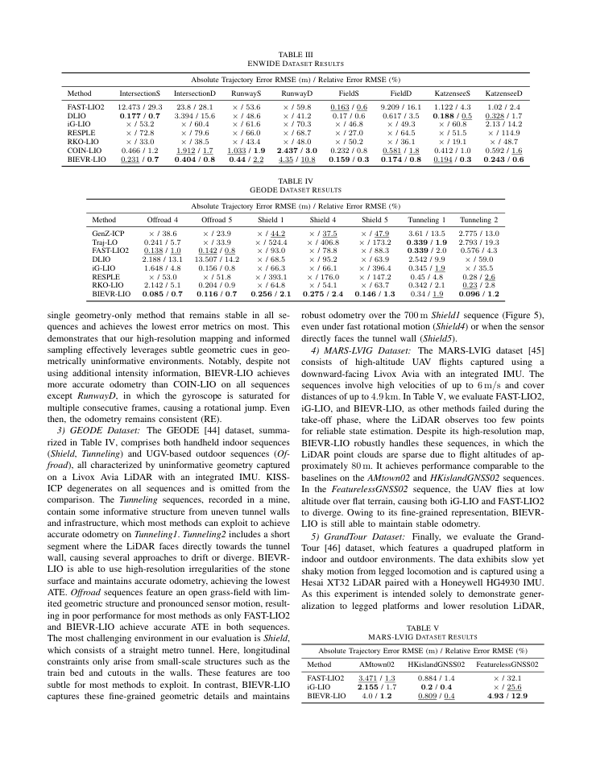

# BIEVR-LIO

论文：[BIEVR-LIO.pdf](../BIEVR-LIO.pdf)。标题为 *BIEVR-LIO: Robust LiDAR-Inertial Odometry through Bump-Image-Enhanced Voxel Maps*（arXiv:2604.14421）。

## 背景和相关研究

隧道、平坦地面、草地等场景看似退化，但常常仍存在轨道床、墙面切口、地面标线等细小几何变化。普通点地图为了实时会强降采样，平面或 Gaussian 体素又会把这些变化平均掉；强度辅助方法能增加约束，却要求传感器有密集且规则的强度信息。

BIEVR 的观察是：地图中已经积累的高分辨率细节可以帮助注册，但当前扫描若均匀低密度采样，就没有点去访问这些细节。因此本文同时改造地图和采样器，并采用“IMU 做去畸变/初始值，LiDAR 注册独立估计位姿，最后用 IMU 优化速度/偏置/重力”的松耦合结构。

## 核心算法和推导

### 1) 定向 bump image

每个边长 $l=0.5 m$ 的体素先维护点数 $n$、一阶和二阶统计量：

$$
\begin{aligned}
s \leftarrow s + \sum_{p_{\mathrm{i}} \in scan} p_{\mathrm{i}} \\
C \leftarrow C + \sum_{p_{\mathrm{i}} \in scan} p_{\mathrm{i}} p_{\mathrm{i}}^\top \\
n \leftarrow n + n_{\mathrm{scan}} \\
\mu = s/n \\
\Sigma = (C - s \mu^\top)/(n+1)
\end{aligned}
$$

符号说明：$p_{\mathrm{i}}$ 是扫描点，$n$ 是体素内点数，$s$ 和 $C$ 分别累计点坐标及其外积；$\mu$、$\Sigma$ 是由这些统计量得到的均值和协方差。

对协方差做 PCA，最小特征值方向为主平面法向。将该平面作为局部图像平面，把每个点投影到 `(u,v)` 像素，并把沿法向的偏差存为高度 $I(u,v)$：

$$
\begin{aligned}
C p_{\mathrm{i}} &= T_{\mathrm{C}}^{G} G p_{\mathrm{i}} \\
u &= [C p_{\mathrm{i}}]_\times/r,  v = [C p_{\mathrm{i}}]_y/r,  z = [C p_{\mathrm{i}}]_z
\end{aligned}
$$

像素用距离相关权重递推：

$$
\begin{aligned}
I(u,v) \leftarrow (W I(u,v) + w_{\mathrm{i}} z_{\mathrm{i}})/(W+w_{\mathrm{i}}) \\
w_{\mathrm{i}} &= \min(0.5, \lVert L p_{\mathrm{i}} \rVert^{-1})
\end{aligned}
$$

符号说明：$I(u,v)$ 是像素高度，$W$ 是该像素已有的累计权重，$w_i$ 是新点的距离权重，$z_i$ 是新点沿图像法向的高度；$\lVert Lp_i\rVert$ 表示 LiDAR 系中的量程。

然后用一像素半径的 Gaussian filter 抑制像素噪声。若平面法向变化超过 3 度，则把旧图像投影到新平面坐标系再重建。这样图像保留锐利的不连续和微小起伏，不必每次重建昂贵的连续函数。

### 2) MID 和双分辨率地图感知采样

高度图的 Mean Image Distance（MID）作为体素非平面细节指标：

$$
\begin{aligned}
MID &= (1/\lvert \Omega_{\mathrm{obs}} \rvert) \sum_{(u,v) \in \Omega_{\mathrm{obs}}} \lVert I(u,v) \rVert
\end{aligned}
$$

符号说明：$\Omega_{\mathrm{obs}}$ 是已有观测值的像素集合，$|\Omega_{\mathrm{obs}}|$ 是其像素数；MID 对这些像素的高度幅值取平均。

采样分两步：

1. 先以 `0.1 m` 高分辨率下采样，并用 IMU 初始位姿变到世界系；选择 MID 最大的 300 个体素，保留其中全部高分辨率点。
2. 其他体素以 `0.5 m` 粗分辨率采样。

所以算力集中在地图已证实有细节的位置，而不是平均撒在天空、平面地面等低信息区域。

### 3) 高度图注册和 Jacobian

位姿增量 $\xi$ 下，点在体素图像坐标系中的高度残差为：

$$
\begin{aligned}
r_{\mathrm{i}}(\xi) &= [C p_{\mathrm{i}}(\xi)]_z - I(u_{\mathrm{i}}(\xi),v_{\mathrm{i}}(\xi)) \\
C p_{\mathrm{i}}(\xi) &= T_{\mathrm{C}}^{G} T_{\mathrm{G}}^{I} \operatorname{Exp}(\xi) I p_{\mathrm{i}}
\end{aligned}
$$

其 Jacobian 分成两项：

$$
\begin{aligned}
\partial r_{\mathrm{i}}/\partial \xi \\
 &= \partial [C p_{\mathrm{i}}]_z/\partial \xi \\
- \partial I(u_{\mathrm{i}},v_{\mathrm{i}})/\partial \xi
\end{aligned}
$$

第一项是传统点到平面的法向约束；第二项由图像梯度提供两个沿平面的约束。也就是说，同一高度图同时提供法向和切向几何信息，正是它可以在隧道小起伏中恢复纵向可观测性的原因。注册用带 Huber 损失的 Levenberg-Marquardt：

$$
\begin{aligned}
\xi^* = \operatorname*{arg\,\min}_{\xi} \sum_i \rho(\lVert r_{\mathrm{i}}(\xi) \rVert)
\end{aligned}
$$

符号说明：$\xi$ 是待估计的位姿增量，$r_i$ 是第 $i$ 个点的高度残差，$\rho$ 是 Huber 鲁棒损失；$\partial/\partial\xi$ 表示对位姿增量求导。

### 4) 松耦合状态结构

IMU 预积分负责点级去畸变和注册初始位姿；位姿 $T_{\mathrm{G}}^{\mathrm{I}}$ 只由高度图注册决定，不把 IMU 残差直接混入该注册目标。之后在 10 s 滑动窗口内固定已估计的姿态，优化速度、重力和偏置，使惯性状态时间上一致。这避免在长退化区间里因 IMU 权重调得过大而淹没细小几何梯度。

地图用 Morton code 哈希、O(1) 平均访问和 LRU 控制体素数量；完整未下采样点可用于地图更新，因为图像像素更新是廉价且可并行的。

## 实验流程和结果

论文使用 Newer College、ENWIDE、GEODE、MARS-LVIG、GrandTour 等数据，覆盖 Ouster、Livox、Hesai 传感器、手持/UAV/UGV/四足平台。参数在不同数据和传感器间统一：体素 `0.5 m`、图像分辨率 `0.05 m`、粗/细采样 `0.5/0.1 m`、高分辨率体素数 300、IMU 窗口 10 s；CPU 为 i7-11800H。

Newer College 结果（Table II，ATE RMSE m / 10 m 相对误差 %）：

| 序列 | FAST-LIO2 | COIN-LIO | BIEVR-LIO |
| --- | ---: | ---: | ---: |
| QuadHard | 0.049/0.3 | 0.046/0.3 | 0.051/0.3 |
| Cloister | 0.078/0.2 | 0.078/0.3 | **0.053/0.2** |
| Stairs | 发散/3497.2 | 0.102/0.7 | **0.056/0.6** |
| Park | 0.310/0.6 | 0.287/0.5 | 0.798/0.6 |

ENWIDE（Table III）中，BIEVR-LIO 在 8 个序列均完成；例如 IntersectionS `0.231/0.7`、FieldS `0.159/0.3`、KatzenseeD `0.243/0.6`。在 GEODE（Table IV）最困难的 Shield1/4/5 上仍为 `0.256/2.1`、`0.275/2.4`、`0.146/1.3 m/%`，而多数基线发散；Tunneling2 为 `0.096/1.2`。

消融（Table VII）最能说明“地图细节 + 正确 Jacobian + 采样”三者缺一不可：

| 配置 | Shield1 ATE | FieldS ATE | Cloister ATE |
| --- | ---: | ---: | ---: |
| 仅 voxel 主平面 | 发散 | 0.051 | 0.058 |
| BIEVR，不用图像梯度 | 0.170 | 0.058 | 0.059 |
| BIEVR + 图像梯度 + 随机双分辨率 | 0.604 | 0.218 | 0.113 |
| BIEVR + 图像梯度 + MID 采样 | **0.256** | **0.159** | **0.053** |

在 Shield1/FieldS/Cloister，MID 采样注册点数为 `5039/5187/7574`，每帧 `12.8/12.3/22.6 ms`；全局高分辨率采样为 `13907/20423/33320` 点、`15.7/17.2/29.8 ms`。Fig. 5 展示 700 m 隧道中轨道床和墙面切口仍清晰；Fig. 7 的四足实验把 BIEVR 导出为 4 x 4 m 高程图，导出约 1 ms，并完成木托盘障碍和楼梯行走。

## 总结

BIEVR-LIO 把“细节是否存在”从地图中显式提取出来，再反过来指导采样。它适合解释为什么同一体素平面在普通 LIO 中不可观，而在高分辨率高度图中可观。限制是像素不能自动填充，低线数、快速运动或初始位姿较差时可能没有足够有效像素；纯几何严格退化时仍需要强度、回环或其他外部约束。

---

## 2026-11-15 对 PV-LIO-PLUS 的范围说明

- 作者 ROS1 源码与独立上游构建均有记录；BIEVR-LIO 在 PV-LIO-PLUS 中尚未集成，目前只有移植设计草稿。该上游构建不是本框架的集成验收。后续移植须保留高度图结构，不能以通用点容器替代。
- 可研究高度图像素、缺失值、图像梯度 Jacobian/Huber 观测如何映射到共同状态和滤波器。不得调用 `computeTransformation`、`stepLm` 或另一个惯性优化器。
- MID 驱动的地图引导采样须单列、记录或消融；成熟体素不保留通用 kNN 点集这一事实影响适配选择，但不改变高度图结构的候选资格。

## 共同 IKFoM 移植设计（2026-11-15）

[移植设计草稿](../../doc/BIEVR_IKFOM_PORT.md)按固定作者源码核对原 LM 注册、Ceres 惯性窗口、定向高度图和像素残差，给出共享滤波下的 h/H/information 方案。源码实际使用 IMU 系量程和 n−1 scatter，须与本文所述论文公式及版本单独对照；当前未重新逐式核定原文，不据此改写论文结论。方案尚未实施，原生梯度近似、噪声尺度及分组/索引边界是前置验证项。
