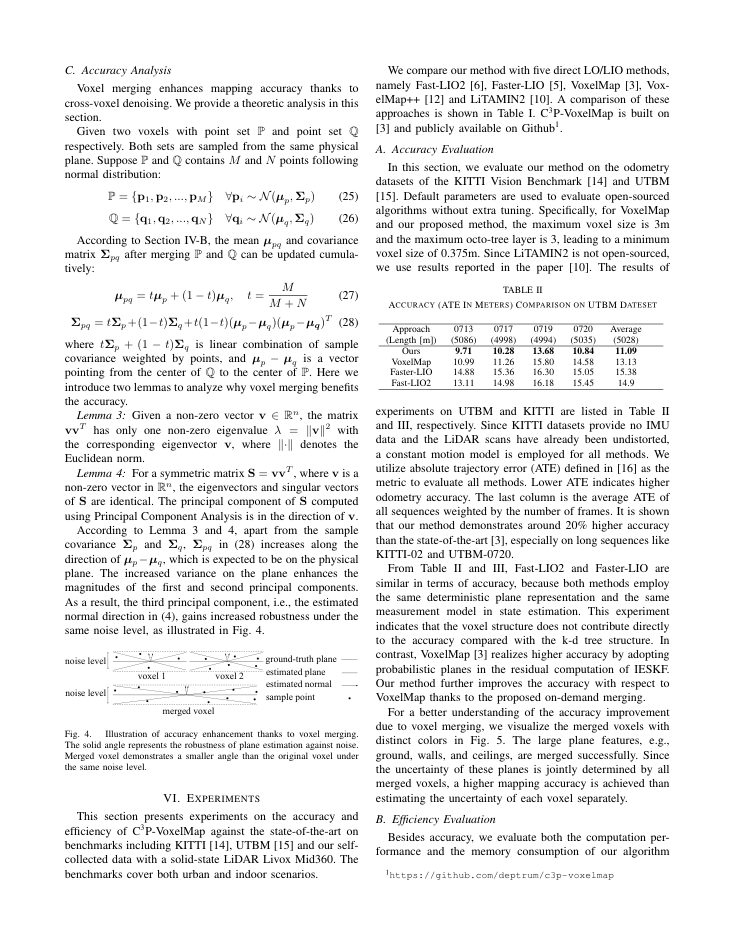

# C3P-VoxelMap

论文：[C3P-VoxelMap.pdf](../C3P-VoxelMap.pdf)。标题为 *C3P-VoxelMap: Compact, Cumulative and Coalescible Probabilistic Voxel Mapping*。

## 背景和相关研究

VoxelMap 在每个自适应体素中拟合带不确定性的平面，较普通点地图更紧凑，也能把 LiDAR 噪声和位姿不确定性传递到残差中。但传统概率体素更新在每次新点加入后，往往需要重新访问历史点并重新计算平面参数与协方差；若当前点数为 $N$、迭代次数为 $M$，代价会接近 `O(MN)`，内存也随点数增加。VoxelMap++ 通过合并共面体素改善了地图大小，但仍需要寻找可合并体素。

C3P 的三个关键词分别对应：不保存全部点的 compact、直接利用统计量更新不确定性的 cumulative，以及按需发现并合并共面体素的 coalescible。

## 核心算法和推导

### 1) 概率平面与点不确定性

对点集 $p_{\mathrm{i}}$，令

$$
\begin{aligned}
q &= (1/N) \sum_i p_{\mathrm{i}} \\
A &= (1/N) \sum_i p_{\mathrm{i}} p_{\mathrm{i}}^\top - q q^\top
\end{aligned}
$$

对 $A$ 做特征分解或 SVD：

$$
\begin{aligned}
A &= U \operatorname{diag}(\lambda_{\mathrm{1}}, \lambda_{\mathrm{2}}, \lambda_{\mathrm{3}}) U^\top, \\
\lambda_{\mathrm{1}} \ge \lambda_{\mathrm{2}} \ge \lambda_{\mathrm{3}} \\
n &= u_{\mathrm{3}}
\end{aligned}
$$

符号说明：$N$ 是点数，$q$ 是点集均值，$A$ 是协方差；$U$ 的列向量是特征向量，$\lambda_1\ge\lambda_2\ge\lambda_3$ 是对应特征值，最小特征方向 $u_3$ 是平面法向。

其中 $q$ 是平面中心，最小特征值方向 $u_{\mathrm{3}}$ 是平面法向量。将每个点视为带噪声的 $p_{\mathrm{i}} + \delta p_{\mathrm{i}}$，把平面参数写成 $f(p_{\mathrm{1}},...,p_{\mathrm{N}})=[n,q]$，一阶展开为：

$$
\begin{aligned}
[n_{\mathrm{gt}}, q_{\mathrm{gt}}] \approx [n, q] + \sum_i (\partial f / \partial p_{\mathrm{i}}) \delta p_{\mathrm{i}}
\end{aligned}
$$

因此平面参数协方差为：

$$
\begin{aligned}
\Sigma_{\mathrm{nq}} = \sum_i (\partial f / \partial p_{\mathrm{i}}) \Sigma_{\mathrm{pi}} \\
(\partial f / \partial p_{\mathrm{i}})^\top
\end{aligned}
$$

符号说明：$\delta p_i$ 是第 $i$ 个点的扰动，$\Sigma_{pi}$ 是该点协方差，$f$ 将点集映射为平面参数 $[n,q]$；$\Sigma_{nq}$ 描述法向和中心的联合不确定性。

中心的导数是 $\partial q / \partial p_{\mathrm{i}} = I/N$。法向量导数来自特征向量扰动：对 $m \ne 3$，论文给出

$$
\begin{aligned}
F_{\mathrm{m}} &= ((p_{\mathrm{i}}-q)^\top (u_{\mathrm{m}} n^\top + n u_{\mathrm{m}}^\top)) / (N (\lambda_{\mathrm{3}}-\lambda_{\mathrm{m}})) \\
\partial n / \partial p_{\mathrm{i}} = U [F_{\mathrm{1}}, F_{\mathrm{2}}, F_{\mathrm{3}}]^\top
\end{aligned}
$$

符号说明：$m$ 遍历非最小特征方向，$F_m$ 是点扰动造成法向变化的系数；$\lambda_3-\lambda_m$ 越小，法向估计越敏感。

$F_{\mathrm{3}}=0$。这说明当 $\lambda_{\mathrm{3}}$ 接近其他特征值时，法向量不稳定，平面协方差会变大；这比只用固定距离阈值更能反映几何可观测性。

### 2) 累积更新和 69 个统计量

新点加入后，中心可以直接更新：

$$
\begin{aligned}
q' &= (N q + p) / (N + 1) \\
A' &= N/(N+1) (A + q q^\top) + 1/(N+1) p p^\top - q' q'^\top
\end{aligned}
$$

符号说明：$p$ 是新加入的点，$N,q,A$ 是加入前的点数、均值和协方差，撇号表示加入该点后的量。

再对 `A'` 做一次小规模 SVD 得到新法向量。难点是 $\Sigma_{\mathrm{nq}}$ 中含有对所有点的导数项。C3P 将这些导数展开为与点数无关的累积二阶统计量，并在更新时只更新这些统计量，不重新遍历历史点。论文报告总共维护 $6 \times 6 + 3 \times 9 + 6 = 69$ 个标量，因此相对于点数的空间复杂度从 `O(N)` 降为 `O(1)`，不确定性更新的时间复杂度从 `O(MN)` 降为 `O(N)`。

### 3) 5-DoF 平面哈希和按需合并

平面用五个量描述：法向的两个角度、法向距离，以及平面内中心坐标 `(u,v)`。将这五个量分别按桶宽量化，组成 locality-sensitive hash key。某个桶积累足够多的体素后：

1. 选点数最多的体素作为参考，减少把低质量平面作为基准的概率。
2. 检查候选平面的法向和几何不确定性；候选需满足论文中的平面特征值比例条件，例如 $\lambda_{\mathrm{3}}/\lambda_{\mathrm{1}} < \eta$、$\lambda_{\mathrm{3}}/\lambda_{\mathrm{2}} < \eta$。
3. 对通过检查的两个 Gaussian 统计量做合并。若点数为 `M,N`，$t=M/(M+N)$，则

$$
\begin{aligned}
\mu_{\mathrm{pq}} = t \mu_{\mathrm{p}} + (1-t) \mu_{\mathrm{q}} \\
\Sigma_{\mathrm{pq}} = t \Sigma_{\mathrm{p}} + (1-t) \Sigma_{\mathrm{q}} \\
+ t(1-t)(\mu_{\mathrm{p}}-\mu_{\mathrm{q}})(\mu_{\mathrm{p}}-\mu_{\mathrm{q}})^\top
\end{aligned}
$$

符号说明：下标 $p,q$ 区分待合并的两个 Gaussian 体素，$M,N$ 是各自点数，$t=M/(M+N)$ 是合并权重；$\mu$ 和 $\Sigma$ 分别为均值和协方差。

最后把多个体素指向同一个合并平面。交叉体素的均值差会增加面内方差，降低错误法向的敏感性；这也是合并不只是节省内存、还可能改善平面稳定性的原因。

## 实验流程和结果

实验使用 KITTI、UTBM 以及 Livox Mid-360 自采数据，算法公平性测试采用单线程；最大体素边长 3 m，八叉树最大层数 3，最小体素边长 0.375 m。KITTI 无 IMU，使用恒速模型。评价包括 ATE、运行时间和内存。

UTBM 的 ATE（m，越小越好，论文 Table II）：

| 方法 | 0713 | 0717 | 0719 | 0720 | 平均 |
| --- | ---: | ---: | ---: | ---: | ---: |
| C3P-VoxelMap | 9.71 | 10.28 | 13.68 | 10.84 | 11.09 |
| VoxelMap | 10.99 | 11.26 | 15.80 | 14.58 | 13.13 |
| Faster-LIO | 14.88 | 15.36 | 16.30 | 15.05 | 15.38 |
| FAST-LIO2 | 13.11 | 14.98 | 16.18 | 15.45 | 14.90 |

关键效率结果（论文 Table IV）：总平均每帧时间为 C3P 合并 `40.43 ms`、不合并 `36.97 ms`，VoxelMap `50.84 ms`，Faster-LIO `56.75 ms`，FAST-LIO2 `43.69 ms`。在 C3P 合并版本中，状态估计约 `31.37 ms`、地图操作约 `9.06 ms`。内存实验（Table V）中，C3P 在 KITTI 04/06/09 和 Indoor 上分别为 `243.7/315.9/878.7/229.6 MB`，对应 VoxelMap `521.0/1433.6/2150.4/1433.6 MB`。

关键图表：

- 第 1 页 Fig. 1 对比了普通体素平面的偏差-方差权衡。
- 第 6 页 Table II 说明合并后的 UTBM 精度整体优于未合并基线。
- 第 7 页 Table III/IV 分别给出 KITTI 精度和运行时间；第 8 页 Fig. 6 展示时间随地图层数/规模的变化。
- 第 7-8 页 Fig. 5/6 说明合并可使墙、地面、天花板等大平面统一，且点数增加时保持近似常量存储。

## 总结

C3P 的核心价值不是换一种残差，而是把“概率平面不确定性更新”变成可累积、可合并的统计量。对 PV-LIO-PLUS，最直接的参考是平面参数协方差的状态分离、统计量复用，以及按需而不是全局扫描式的共面合并。

---

## 2026-11-15 对 PV-LIO-PLUS 的范围说明

- C3P-VoxelMap 的概率体素统计、共面合并及原生匹配/平面不确定性观测已作为一条集成分支。
- 主路线评估地图与配套残差权重；它不与点图拟平面观测天然等价。统一观测是单独可选的严格地图消融。
- 论文系统的性能数字不等于本仓库回放结果；构建和运行证据分别见[工作空间报告](../../doc/workspace/BUILD_REPORT.md)。
