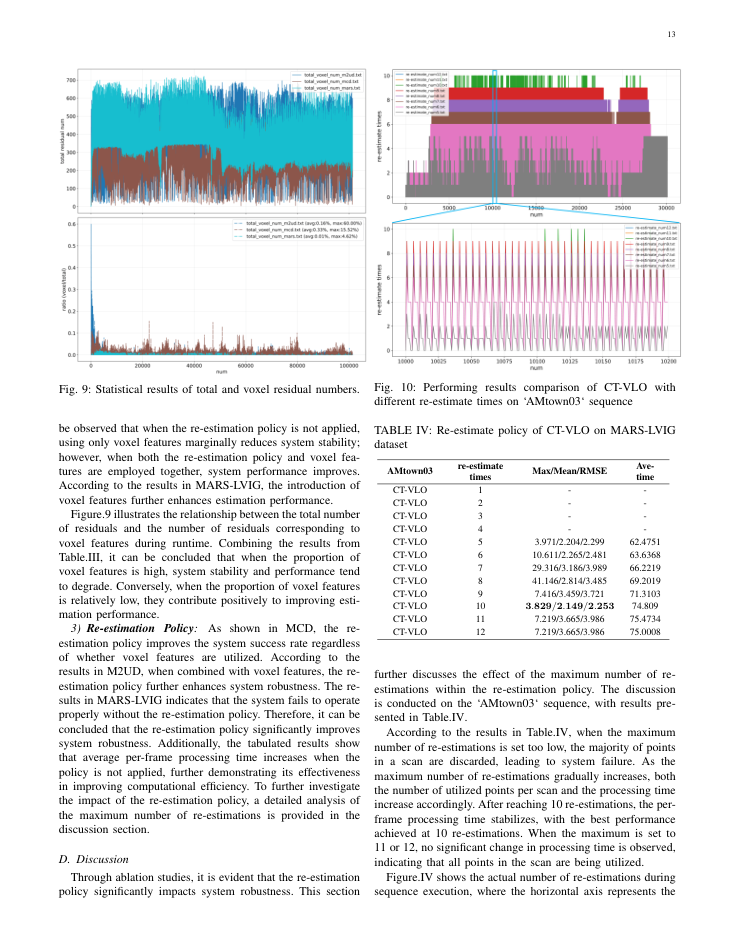

# CT-VoxelMap

论文：[CT-VoxelMap.pdf](../CT-VoxelMap.pdf)。标题为 *CT-VoxelMap: Efficient Continuous-Time LiDAR-Inertial Odometry with Probabilistic Adaptive Voxel Mapping*（arXiv:2604.03747）。

## 背景和相关研究

普通离散时间 LIO 通常把一帧 LiDAR 点去畸变到统一时刻；当 LiDAR、IMU、相机不同步，或者平台在一帧扫描期间快速转动时，单一时刻近似会产生误差。连续时间方法可在任意时间查询姿态，但已有方法常直接优化控制点，导致旋转边界条件、四元数 Jacobian 和轨迹拟合误差处理较复杂。

CT-VoxelMap 采用累计形式的 Lie-group cubic B-spline，以“相邻控制姿态增量”而不是控制姿态本身作为状态；同时把 spline 拟合误差显式放进观测不确定性，并用平面/体素混合特征和预测-重估循环提高鲁棒性。

## 核心算法和推导

### 1) 累计 cubic B-spline 和增量状态

设 knot 间隔为 $\Delta t$、阶数 $N=4$，区间内归一化时间为 $u$。旋转和平移的累计形式为：

$$
\begin{aligned}
R(t) &= R_{\mathrm{i}} \prod_{j=1}^{N-1} \\
\operatorname{Exp}(\lambda_{\mathrm{tilde,j}}(u) \operatorname{Log}(R_{i+j-1}^\top R_{i+j})) \\
p(t) &= p_{\mathrm{i}} + \sum_{j=1}^{N-1} \\
\lambda_{\mathrm{tilde,j}}(u) (p_{i+j}-p_{i+j-1})
\end{aligned}
$$

利用 $\lambda_{\mathrm{tilde}}_0=1$，可改写成统一的增量链：

$$
\begin{aligned}
d_{\mathrm{Rj}} &= \operatorname{Log}(R_{i+j-1}^\top R_{i+j}) \\
d_{\mathrm{pj}} &= p_{i+j} - p_{i+j-1} \\
R(t) &= R_{i-1} \prod_{j=0}^{N-1} \operatorname{Exp}(\lambda_{\mathrm{tilde,j}} d_{\mathrm{Rj}}) \\
p(t) &= p_{i-1} + \sum_j \lambda_{\mathrm{tilde,j}} d_{\mathrm{pj}}
\end{aligned}
$$

符号说明：$R(t),p(t)$ 是时刻 $t$ 的姿态和平移，$i$ 标记当前 knot 区间，$j$ 遍历局部增量，$N$ 是样条阶数；$u$ 是归一化时间，$\tilde\lambda_j$ 是累计基函数权重，$d_{Rj},d_{pj}$ 是相邻 knot 的旋转和平移增量。

对旋转增量递推角速度。令 $A_{\mathrm{j}}=Exp(\lambda_{\mathrm{tilde}}_j d_{\mathrm{Rj}})$，则：

$$
\begin{aligned}
\omega^{j+1} = A_{\mathrm{j}}^\top \omega^{j} + \dot{\lambda_{\mathrm{tilde,j}}} d_{\mathrm{Rj}} \\
\omega^{0} = 0 \\
v(t) &= \sum_j \dot{\lambda_{\mathrm{tilde,j}}} d_{\mathrm{pj}} \\
a(t) &= \sum_j \ddot{\lambda_{\mathrm{tilde,j}}} d_{\mathrm{pj}}
\end{aligned}
$$

符号说明：$\omega,v,a$ 分别是角速度、线速度和线加速度；点号表示对时间求导，$A_j$ 是第 $j$ 个旋转增量对应的旋转矩阵。

这样加速度、角速度和位置都由同一组增量直接生成。新时间段到来时，只需移位增量数组，并用上一段最后增量做恒速初始化；避免单独推导 $j=0$ 和 $j=N-1$ 的特殊边界 Jacobian。

### 2) IMU 观测和 Jacobian

IMU 观测模型把 spline 的加速度、角速度与测量、偏置和重力连接起来：

$$
\begin{aligned}
h_B &=
\begin{bmatrix}
R(t)^\top(a(t)+g)+b_a-a_m\\
\omega(t)+b_w-\omega_m\\
b_w-b_w^{\mathrm{tk}}\\
b_a-b_a^{\mathrm{tk}}\\
g\boxminus g^{\mathrm{tk}}
\end{bmatrix}
\end{aligned}
$$

符号说明：$h_B$ 汇总 IMU 测量残差和状态先验残差；$a_m,\omega_m$ 是加速度计和陀螺仪测量，$b_a,b_w$ 是相应偏置，$g$ 是重力。上标 $\mathrm{tk}$ 表示参考 knot 状态，$\boxminus$ 是流形上的差。

例如旋转增量的导数为：

$$
\begin{aligned}
\partial R / \partial d_{\mathrm{Rj}} \\
 &= \lambda_{\mathrm{tilde,j}} P_{\mathrm{j}} J_{\mathrm{r}}(\lambda_{\mathrm{tilde,j}} d_{\mathrm{Rj}})
\end{aligned}
$$

符号说明：$P_j$ 表示该增量之后的旋转乘积，$J_r$ 是 SO(3) 右 Jacobian；此式是旋转对第 $j$ 个增量的导数。

其中 $P_{\mathrm{j}}$ 是后续旋转乘积，$J_{\mathrm{r}}$ 是 SO(3) 右 Jacobian。平移增量对加速度的导数为 $R^{\mathrm{T}} ddot(\lambda_{\mathrm{tilde}}_j) I$，因此可以在同一个误差状态滤波框架中计算 IMU 与 LiDAR 的观测。

### 3) spline 拟合误差和点不确定性

离散控制姿态与 cubic spline 不会严格重合。论文在受影响区间内比较历史估计姿态、IMU 前向传播姿态和 spline 插值姿态，得到旋转/平移误差样本 $\delta \theta_{\mathrm{m}}, \delta p_{\mathrm{m}}$，用样本协方差估计：

$$
\begin{aligned}
\Sigma_{\mathrm{R}} = (1/N) \sum_m \delta_{\theta,m} \delta_{\theta,m}^\top \\
\Sigma_{\mathrm{p}} = (1/N) \sum_m \delta_{\mathrm{p,m}} \delta_{\mathrm{p,m}}^\top
\end{aligned}
$$

符号说明：$\delta_{\theta,m}$、$\delta_{p,m}$ 是第 $m$ 个样本的旋转与平移误差，$N$ 是样本数；$\Sigma_R,\Sigma_p$ 分别描述两类误差的不确定性。

LiDAR 点变换为：

$$
\begin{aligned}
G p_{\mathrm{i}} &= R_{\mathrm{I}}^{G}(t) (R_{\mathrm{L}}^{I} Lp_i + p_{\mathrm{L}}^{I}) + p^{G}(t)
\end{aligned}
$$

符号说明：$L p_i$ 是 LiDAR 系点，$R_L^I,p_L^I$ 是 LiDAR 到 IMU 的外参，$R_I^G,p^G$ 将 IMU 系变换到世界系；$G p_i$ 表示变换后的点。

其协方差同时包含 LiDAR 点噪声、位姿旋转不确定性和位移不确定性。这个步骤的关键意义是：连续轨迹表达本身的误差不再被错误地当成零噪声。

### 4) 混合自适应体素特征

对体素内点集求均值 $q$、协方差 $P_{\mathrm{V}}$，并对协方差特征分解。如果能可靠拟合平面，保留平面特征；否则继续细分，叶节点可作为完整 voxel feature。两类残差分别为：

$$
\begin{aligned}
h_{\mathrm{plane}} &= u_{\mathrm{1}}^\top (G p_{\mathrm{i}} - q) \\
h_{\mathrm{voxel}} &= \Lambda^{-1/2} U^\top (G p_{\mathrm{i}} - q)
\end{aligned}
$$

符号说明：$q$ 是体素中心，$U,\Lambda$ 是协方差的特征向量矩阵和特征值对角阵；$u_1$ 是平面残差采用的法向方向，$h_{voxel}$ 则保留三个特征方向的归一化残差。

平面残差只沿法向约束，体素残差在三个特征方向上约束，特征值越小的方向权重越大。观测协方差把平面法向、中心、LiDAR 点以及 spline 位姿误差一起传播。论文还用 3-sigma 门限剔除不一致点；voxel feature 只有三个方向都通过检查才有效。

### 5) 预测-重估策略

短预测区间内，若当前采样点数超过阈值，则把点集分成两部分，重新估计轨迹/状态并重复采样，直到处理完点或达到最大重估次数。其动机是分割后每个子问题的观测矩阵更小，Kalman 增益和协方差计算的高阶矩阵开销降低，同时能减小一整帧跨越大运动时的线性化误差。

## 实验流程和结果

数据包括 MCD、M2UD、MARS-LVIG 和 Diter++，传感器覆盖 Livox Mid-70、Velodyne-16、Livox Avia、Ouster OS1-64/128；评价使用 APE 的最大值/均值/RMSE。结点频率为 MCD 80 Hz、M2UD/MARS 50 Hz、Diter++ 35 Hz，平台为 i5-12400F、16 GB。

公共数据 Table II 的代表性结果（m，格式为 `MAX/RMSE`）：

| 数据/序列 | F-LIO2 | R-LIO | CT-VLO | CT-VLIO |
| --- | ---: | ---: | ---: | ---: |
| MCD ntu-day-01 | 0.901 | 0.549 | 2.639/1.100 | 2.904/1.444 |
| MCD ntu-day-13 | 1.288 | 0.560 | 0.855/0.381 | 2.452/1.229 |
| M2UD plaza03 | 0.831/0.436 | 1.733/0.308 | 2.419/0.644 | 1.435/0.619 |
| M2UD aggressive04 | 失败 | 2.507/0.882 | 2.107/0.690 | 2.118/0.715 |
| MARS AMtown03 | 6.191/3.216 | 20.640/12.630 | 3.971/2.299 | **3.183/2.033** |
| Diter Park-in-day-cam-free | 0.939/0.348 | 0.825/0.416 | 0.581/0.214 | 0.573/0.252 |

作者报告：`aggressive04` 中仅 R-LIO、CT-VLO、CT-VLIO 完成全程；`Park-in-day-cam-free` 2160 s 长序列中 CT-VLO 完成并取得最佳 APE；MARS 的快速转弯和起降退化场景中 CT-VLIO 在 AMtown03 最好。CT-VLO 是 LiDAR-only 模式，CT-VLIO 使用 IMU；在 IMU 突变明显的 rough-terrain 序列中，错误的 IMU 信息反而可能降低结果。

消融 Table III：不考虑 spline 拟合误差时三个数据集均为 `0/10` 成功；MARS AMtown03 中完整方法 RMSE `2.299 m`、成功率 `10/10`，不使用 voxel feature 为 `2.939 m`、`10/10`，不使用重估为失败；M2UD 完整方法 RMSE `0.677 m`、成功率 `10/10`。重估次数讨论（Table IV）显示 AMtown03 在最多 5 次时已能完成，最多 10 次的 RMSE `2.253 m`，但时间由约 `62.5 ms` 增至 `74.8 ms`。

关键图表：第 8 页 Fig. 8 比较 aggressive04/AMtown03 的轨迹；第 9 页 Fig. 9 显示总残差与 voxel 残差数量；第 13 页 Fig. 9/10 和 Table IV 说明重估次数与处理时间、稳定性的关系；第 14-15 页 Fig. 12/13 给出轮腿机器人和 botanical 自采数据，RMSE 为 `1.723/0.877/2.008 m`（CT-VLO）和 `1.711/0.821/2.025 m`（CT-VLIO）。

## 总结

CT-VoxelMap 的论文贡献围绕连续时间状态、拟合误差与重估策略共同展开。现有证据未证明独立地图结构改进，因此作为相关连续时间估计研究归档；完整连续时间模型需作为独立估计器范围评估。

---

## 2026-11-15 对 PV-LIO-PLUS 的范围说明

- 现有本地来源记录未确认作者官方源码；本地固定快照中未证实独立地图路径，不据此断言远程不存在实现。
- 当前证据未证明其对既有地图作了独立的结构改进，因此列为连续时间估计相关论文归档，不进入地图候选或实施排期。论文中的 B-spline 状态、时间观测和重估流程改变估计器；完整连续时间系统可作为单独端到端基线。
- 本文数字和实验条件属于论文版本，不表示 CT-VoxelMap 已本地实现或复现。
