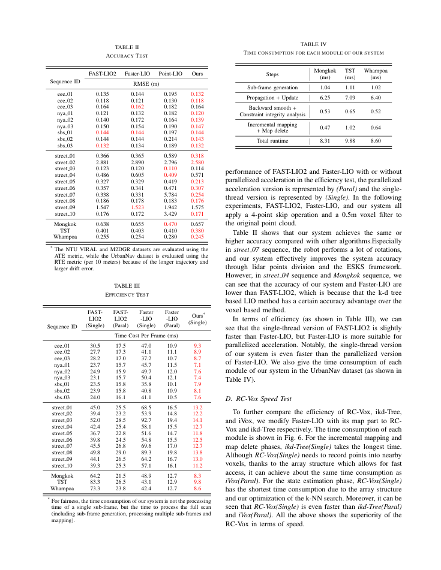

# FR-LIO

论文：[FR-LIO.pdf](../FR-LIO.pdf)。标题为 *Fast and Robust Lidar-Inertial Odometry by Tightly-Coupled Iterated Kalman Smoother and Robocentric Voxels*（arXiv:2302.04031）。

## 背景和相关研究

激进运动时，IMU 频率和积分误差会使整帧 LiDAR 去畸变不准；把整帧拆成更短时间段可以降低积分区间，但每个子帧点数少、约束不足，单独更新容易退化。另一方面，ikd-Tree 和 iVox 的邻域查询仍占主要计算时间。

FR-LIO 用运动强度自适应生成子帧，再用历史和未来子帧的紧耦合迭代误差状态 Kalman smoother（ESKS）向后平滑，恢复退化方向。地图侧用固定大小、以机器人为中心的两层数组 RC-Vox，配合把邻域点预先写入周围体素的 KNN 优化。

## 核心算法和推导

### 1) 运动强度到子帧数

统计当前扫描对应 IMU 加速度和角速度的标准差，令历史统计得到的最大值为 $\sigma_{\mathrm{acc}}_\max, \sigma_{\mathrm{gyr}}_\max$，则：

$$
\begin{aligned}
n_{\mathrm{curr}} &= \operatorname{ceil}(n_{\max} * \max( \\
\sigma_{\mathrm{acc,curr}}/\sigma_{\mathrm{acc,\max}}, \\
\sigma_{\mathrm{gyr,curr}}/\sigma_{\mathrm{gyr,\max}}))
\end{aligned}
$$

符号说明：$n_{curr}$ 是当前扫描的子帧数，$n_{max}$ 是上限；$\sigma_{acc,curr},\sigma_{gyr,curr}$ 是当前扫描的加速度和角速度波动，带 $\max$ 的量是历史归一化上限。

运动越激烈，子帧越多，单个子帧内的 IMU 传播误差越小；运动平稳时减少子帧，避免稀疏更新。

### 2) 子帧 IESKF 更新和 ESKS 向后平滑

状态为 $p,v,q,b_{\mathrm{a}},b_{\mathrm{g}},g$，误差状态维度 18。每个子帧先用 IMU 传播和运动补偿，再以点到平面残差进行 IESKF 更新：

$$
\begin{aligned}
K &= (H^\top \mathbb{R}^{-1} H + P^{-1})^{-1} H^\top \mathbb{R}^{-1} \\
x_{k+1} &= x_{\mathrm{k}} + K(0-h(x_{\mathrm{k}})) \\
P_{\mathrm{k}} &= (I-KH)P_{\mathrm{k}}
\end{aligned}
$$

符号说明：$x_k,P_k$ 是第 $k$ 个子帧的状态及协方差，$H$ 是观测 Jacobian，$\mathbb R$ 是测量噪声协方差，$K$ 是滤波增益，$h(x_k)$ 是观测残差。

所有属于当前整帧的子帧处理完后，从最后一个子帧向前执行 RTS 风格平滑：

$$
\begin{aligned}
G_{\mathrm{k}} &= P_{\mathrm{k}} F_{\mathrm{k}}^\top (P_{k+1}^-)^{-1} \\
x_{\mathrm{k}}^{s} &= x_{\mathrm{k}}^{u} + G_{\mathrm{k}} (x_{k+1}^{s} - x_{k+1}^-) \\
P_{\mathrm{k}}^{s} &= P_{\mathrm{k}} + G_{\mathrm{k}}(P_{k+1}^{s}-P_{k+1}^-)G_{\mathrm{k}}^\top
\end{aligned}
$$

符号说明：上标 $s$ 表示平滑结果，$u$ 表示前向滤波更新结果，$-$ 表示预测值；$F_k$ 是状态转移 Jacobian，$G_k$ 是向后平滑增益。

论文讨论了误差状态 reset 与 smoother 的兼容问题：临时取消 reset，在未 reset 的误差状态上做传播、更新和后向平滑，再把修正量加回名义状态。最后用协方差最小特征值检查某个子帧是否仍退化，只有约束充分的子帧才进入地图。

### 3) Robocentric voxel 和邻域 KNN

RC-Vox 在机器人周围维护一个固定大小立方体。顶层数组 TLA 以地图原点、机器人当前位置和网格边长做 floor/modulo 映射；每个 TLA 单元含一个 BLA，BLA 再按更小体素索引存点。机器人移动时，移出局部立方体的数组格被复用并清空，因此地图维护不随全局范围增长。

为加快 KNN，插入点时同时登记到中心体素附近的 6/18/26 个邻域体素；查询时只访问中心体素中已经登记的点，再计算距离取最小 K 个。代价是地图更新时多写几份索引，收益是把重复的邻域遍历从高频状态更新阶段移到低增量的地图更新阶段。

## 实验流程和结果

实验覆盖 NTU VIRAL、M2DGR、UrbanNav、Newer College 和自采 indoor，27 个序列；平台为 Ryzen 7 4800H、16 GB。统一 0.5 m 体素滤波和 4 点跳过。激进运动自采数据角速度最高 `21.8 rad/s`。

精度 Table II 的平均值和 UrbanNav 模块时间：

| 指标 | FAST-LIO2 | Faster-LIO | FR-LIO |
| --- | ---: | ---: | ---: |
| NTU/M2DGR/UrbanNav 综合表中平均表现 | 论文逐序列报告 | 论文逐序列报告 | 与基线相当或更优 |
| UrbanNav Mongkok 每帧（ms） | 64.2 | 48.9 | **8.3** |
| UrbanNav TST 每帧（ms） | 83.3 | 43.1 | **9.8** |
| UrbanNav Whampoa 每帧（ms） | 73.3 | 42.4 | **8.6** |

论文 Table II 中，FR-LIO 在 `street01/05/06/07/08/10` 的 RMSE 分别为 `0.318/0.213/0.307/0.254/0.176/0.171 m`；在整体精度正常的序列中与 FAST-LIO2、Faster-LIO 接近。Newer College 和自采激进运动 Fig. 4/5 显示 FAST-LIO2 失败或出现重影时，子帧 + ESKS 仍能保持轨迹连续。

RC-Vox 的模块对比 Fig. 6：单线程 RC-Vox 的状态估计和地图维护均低于 ikd-Tree，并可接近或超过 iVox 并行版本。Table IV 中完整系统在 Mongkok/TST/Whampoa 的总时间为 `8.31/9.88/8.60 ms`。

## 总结

FR-LIO 把激进运动问题拆成两个互补问题：短时间子帧减少去畸变误差，后向平滑补足短子帧约束；同时用机器人中心固定数组控制地图访问和内存。对 PV-LIO-PLUS，ESKS 的收益依赖子帧时间顺序和 shutdown/缓存管理，不能只移植子帧划分公式。

---

## 2026-11-14 地图替换边界

- 范围审查只把 RC-Vox 列为理论候补：固定两层数组、机器人中心滑动和邻域索引可能独立，但本轮未核验作者源码及实现符号。
- 自适应子帧和 ESKS 平滑改变扫描/状态更新流程，明确排除在地图替换之外。
- 在出现可核验地图实现前，RC-Vox 不列为已具备实现的候选；本文结果属于完整 FR-LIO 系统。
- 详见[范围审查](MAP_BACKEND_SCOPE_REVIEW.md)。本笔记不表示后端已经接入。
