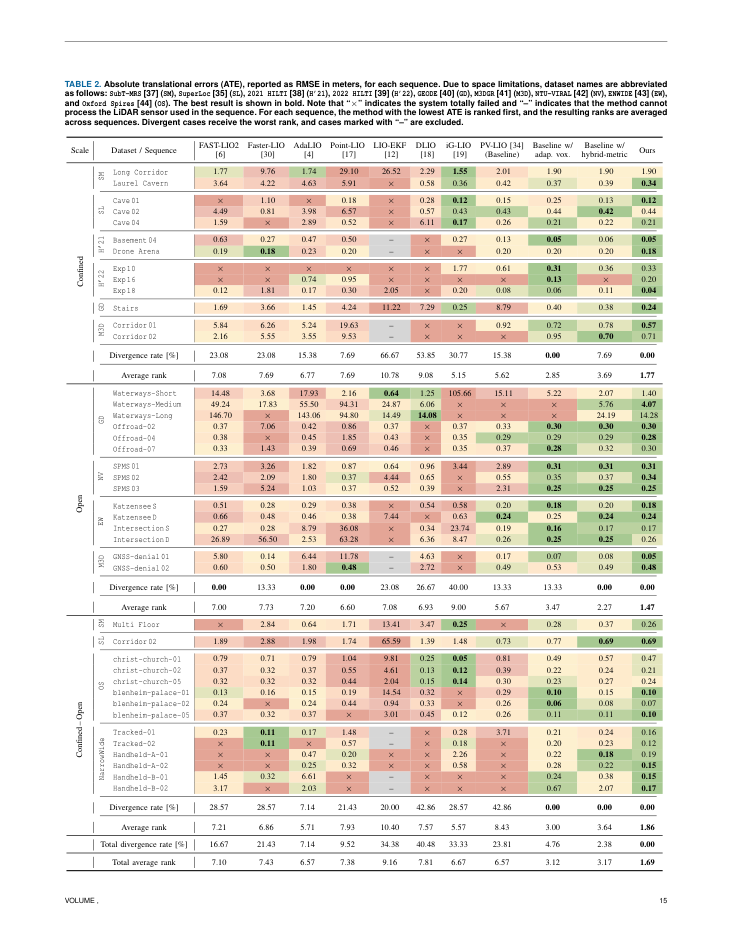

# GenZ-LIO

本文的推导、实验数字和配图基于论文 **v2**：[GenZ-LIO-v2.pdf](../GenZ-LIO-v2.pdf)，标题为 *GenZ-LIO: Generalizable LiDAR-Inertial Odometry Beyond Confined-Open Boundaries*（arXiv:2603.16273v2）。最新论文为 **v3**：[GenZ-LIO.pdf](../GenZ-LIO.pdf)（arXiv:2603.16273v3）；v2 与 v3 不应混用实验结论，主体不代表对 v3 的完整总结，文末另附 v3 独立摘要。

v3 已发布官方源码：[cocel-postech/genz-lio](https://github.com/cocel-postech/genz-lio)，包含独立 C++/Python 实现以及 ROS 1、ROS 2 接口。

## 背景和相关研究

固定体素大小隐含了固定空间尺度：在狭窄空间，开放场景预设的大体素会过度降采样；在开阔空间，狭窄场景预设的小体素又产生大量点。几何度量也有互补性：点到平面适合有可靠法向的密集结构，点到点适合稀疏、非结构化或平面不稳定的区域。

GenZ-LIO 将尺度调节、残差融合和查询剪枝放在同一条 LIO pipeline 中：以扫描中值距离估计空间尺度，用 PD 控制追踪尺度相关的目标点数；有平面时用点到平面，没有可靠平面时回退到点到点；再用体素下界剪枝减少点到点搜索。

## 核心算法和推导

### 1) 空间尺度和自适应体素化

先用上一时刻体素大小 $d_(t-1)$ 对去畸变扫描临时体素化，计算临时点的距离中值 $m_{\mathrm{t}}$，再以滑动窗口平滑：

$$
\begin{aligned}
m_{\mathrm{bar,t}} &= (1/\lvert W \rvert) \sum_{i=1}^{\lvert W \rvert} m_{t+1-i}
\end{aligned}
$$

符号说明：$m_t$ 是当前扫描临时点到邻点距离的中值，$\bar m_t$ 是长度为 $|W|$ 的滑动平均；$N_{desired,t}$ 是目标点数，$\rho$ 将距离映射为采样比例，$\tau_m$ 是饱和阈值，$p$ 控制曲线形状。

将尺度映射为目标点数：

$$
\begin{aligned}
N_{\mathrm{desired},t} &=
\begin{cases}
N_{\min} + (N_{\max}-N_{\min})\rho(\bar m_t), & \bar m_t < \tau_m,\\
N_{\max}, & \text{otherwise}
\end{cases}\\
\rho(m) &= 1 - (1-m/\tau_m)^p
\end{aligned}
$$

该函数在 $m=0$ 到 $\tau_{\mathrm{m}}$ 之间平滑增长，并在边界导数为零。临时点数为 $N_{\mathrm{temp}},t$，跟踪误差：

$$
\begin{aligned}
e_{\mathrm{t}} &= N_{\mathrm{desired},t} - N_{\mathrm{temp},t} \\
\Delta e_{\mathrm{t}} = (e_{\mathrm{t}}-e_{t-1})/\Delta t_{\mathrm{scan}}
\end{aligned}
$$

符号说明：$N_{temp,t}$ 是临时点数，$e_t$ 是目标与实际点数之差，$\Delta e_t$ 是误差变化率；$d_t$ 是体素边长，$K_p,K_d$ 分别为比例和微分增益，$\Gamma_p,\Gamma_d$ 用于调节增益。

体素大小采用：

$$
\begin{aligned}
\Delta d_{\mathrm{t}} = -K_{\mathrm{p},t} e_{\mathrm{t}} - K_{\mathrm{d},t} \Delta e_{\mathrm{t}} \\
d_{\mathrm{t}} &= \operatorname{clamp}(d_{t-1}+\Delta d_{\mathrm{t}}, d_{\min},d_{\max})
\end{aligned}
$$

负号来自“体素越大，保留点越少”。$K_{\mathrm{p}},K_{\mathrm{d}}$ 由尺度、误差和误差导数的归一化几何平均做 gain scheduling：

$$
\begin{aligned}
\Gamma_{\mathrm{p}} = \sqrt{\phi_{\mathrm{t}} \psi_{\mathrm{p},t}},  \Gamma_{\mathrm{d}} = \sqrt{\phi_{\mathrm{t}} \psi_{\mathrm{d},t}} \\
K_{\mathrm{p}} &= K_{\mathrm{p},\min} + (K_{\mathrm{p},\max}-K_{\mathrm{p},\min}) \Gamma_{\mathrm{p}} \\
K_{\mathrm{d}} &= K_{\mathrm{d},\min} + (K_{\mathrm{d},\max}-K_{\mathrm{d},\min}) \Gamma_{\mathrm{d}}
\end{aligned}
$$

最终用 $d_{\mathrm{t}}/2$ 产生高密度 $V_{\mathrm{merge}},t$ 更新地图，再用 $d_{\mathrm{t}}$ 产生 $V_{\mathrm{t}}$ 做状态更新，兼顾地图细节与计算量。

### 2) 体素剪枝和两类对应

查询点所在 root voxel 被概念上划分为中心、面、边、角四类区域，只选择可能相邻的 0/1/3/7 个邻居，而不是固定访问 26 个邻居。对点到点搜索，先查询 root voxel 得到当前最近距离 $d_{\mathrm{closest}}$，然后计算候选体素到查询点的几何下界 $d_{\mathrm{nbr}}$；若 $d_{\mathrm{nbr}} \ge d_{\mathrm{closest}}$，该体素中任何点都不可能更近，直接跳过。

点到平面对应使用体素保存的法向和中心并做 3-sigma 检验。没有有效平面时回退到点到点，避免因法向不可靠而丢掉全部约束。

### 3) 不确定性加权的混合残差

点到平面模型为：

$$
\begin{aligned}
0 &= n^\top (W T_{\mathrm{I}} T_{\mathrm{L}} (Lp + \delta Lp) - q - \delta q)
\end{aligned}
$$

线性化得到标量残差 $z_{\mathrm{pl}}$、状态 Jacobian $H_{\mathrm{ex}},pl$ 和协方差：

$$
\begin{aligned}
R_{\mathrm{pl}} &= H_{\mathrm{v,pl}} \Sigma_{n,q,Lp} H_{\mathrm{v,pl}}^\top
\end{aligned}
$$

符号说明：$n,q$ 是地图平面的法向和中心，$Lp$ 是 LiDAR 系点，$\Sigma_{n,q,Lp}$ 是这些量的联合协方差；$H_{v,pl}$ 将不确定性传播到残差方差 $R_{pl}$。

点到点不直接使用 3 维向量，而是使用 L2 范数标量：

$$
\begin{aligned}
z_{\mathrm{po}} &= W T_{\mathrm{I}} T_{\mathrm{L}} Lp - W p' \\
z_{\mathrm{norm,po}} &= \lVert z_{\mathrm{po}} \rVert \\
H_{\mathrm{norm,po}} &= (z_{\mathrm{po}}^\top/\lVert z_{\mathrm{po}} \rVert) H_{\mathrm{po}} \\
R_{\mathrm{norm,po}} &= (z_{\mathrm{po}}^\top/\lVert z_{\mathrm{po}} \rVert) R_{\mathrm{po}} (z_{\mathrm{po}}/\lVert z_{\mathrm{po}} \rVert)
\end{aligned}
$$

符号说明：$z_{po}$ 是点差向量，$z_{norm,po}$ 是其长度；$H_{po},R_{po}$ 是向量残差的 Jacobian 和协方差，投影后得到标量残差的 $H_{norm,po},R_{norm,po}$。

再加入体素访问范围和实际检查点数带来的离散化方差：

$$
\begin{aligned}
R_{\mathrm{disc}} &= N_{\mathrm{acc,vox}} d_{\mathrm{root}}^{2} / N_{\mathrm{eval,pt}} \\
R_{\mathrm{comb,po}} &= \lambda_{\mathrm{po}} (R_{\mathrm{norm,po}} + R_{\mathrm{disc}})
\end{aligned}
$$

符号说明：$N_{acc,vox}$ 是访问体素数，$N_{eval,pt}$ 是实际检查点数，$d_{root}$ 是根体素边长；$R_{disc}$ 表示有限搜索带来的离散化方差，$\lambda_{po}$ 调节点到点项权重。

对所有点到平面和点到点项堆叠，在 ESIKF 中求解 MAP：

$$
\begin{aligned}
\min_{\delta x} \lVert x \boxminus x_{\mathrm{hat}} \rVert_{P_{\mathrm{hat}}}^{2} \\
+ \sum_i \lVert z_{\mathrm{i}} + H_{\mathrm{i}} ex \rVert_{R_{\mathrm{i}}}^{2}
\end{aligned}
$$

符号说明：$\delta x$ 是待求状态增量，$x_{hat},P_{hat}$ 是先验状态及协方差；$z_i,H_i,R_i$ 分别是第 $i$ 项观测残差、Jacobian 和协方差，$\boxminus$ 表示流形上的差。

点到平面与点到点共享同一状态、同一先验和同一迭代过程，$\lambda_{\mathrm{po}}$ 用来抵消两种几何支持规模不同造成的原始协方差量级差异。

## 实验流程和结果

实验包括 9 个公开数据集和新采 NarrowWide，共 42 个序列，传感器覆盖 VLP-16、MID-70、PandarXT-32、AVIA、Ouster OS1/OS0、Hesai QT64；平台为 i7-13700K、32 GB。默认 $N_{\mathrm{w}}=5$、目标点数 `[1000,4000]`、体素 `[0.02,1.0] m`、root voxel `0.5 m`、$\lambda_{\mathrm{po}}=0.1$。

Table 2 的代表性 ATE RMSE（m）：

| 场景/序列 | PV-LIO 基线 | 仅自适应体素 | 仅混合度量 | GenZ-LIO |
| --- | ---: | ---: | ---: | ---: |
| 2021 HILTI Basement 04 | 0.13 | 0.05 | 0.06 | **0.05** |
| 2022 HILTI Exp 10 | 0.61 | 0.31 | 0.36 | **0.33** |
| 2022 HILTI Exp 16 | 发散 | 0.13 | 发散 | **0.20** |
| GEODE Stairs | 8.79 | 0.40 | 0.38 | **0.24** |
| GEODE Waterways-Short | 15.11 | 5.22 | 2.07 | **1.40** |
| M3DGR GNSS-denial 01 | 0.17 | 0.07 | 0.08 | **0.05** |
| NarrowWide Tracked-02 | 发散 | 0.20 | 0.23 | **0.12** |
| NarrowWide Handheld-B-02 | 发散 | 0.67 | 2.07 | **0.17** |

全表统计：GenZ-LIO 在测试序列中发散率 `0.00%`，平均 rank `1.69`；仅自适应体素基线和仅混合度量基线分别为 `7.69%` 和 `0.00%` 的总发散率。Exp16 中固定体素方法常因狭窄楼梯点数骤减而失败；Waterways-Short 中混合点到点约束改善了 x/z 平移和 pitch 的退化。

尺度控制消融 Table 3（Handheld-A-01）：

| 方法 | CPU 均值/% | 时间均值/p95 ms | RTE RMSE/cm | ATE RMSE/m |
| --- | ---: | ---: | ---: | ---: |
| Baseline | 270.12 | 16.83/36.70 | 失败 | 失败 |
| + LOCUS 2.0 | 273.92 | 20.98/42.65 | 1.49 | 0.29 |
| + AdaLIO | 294.57 | 24.14/50.35 | 1.56 | 0.34 |
| + LIVOX-CAM | 245.93 | 19.60/34.59 | 1.60 | 0.30 |
| + GenZ-LIO | **212.23** | **16.64/26.24** | **1.42** | **0.16** |

控制消融 Table 4：GenZ-LIO 的 IAE $6.04 \times 10^{3}$、overshoot `0.09`、ATE `0.13 m`，优于线性缩放 `14.03/0.24/0.21`、固定增益 `53.74/1.63/0.24` 和 volume-based scaling `270.71/0.87/0.34`。Fig. 12 显示剪枝搜索在 Offroad-04 上保持 ATE 基本不变，同时降低 correspondence search 时间。

## 总结

GenZ-LIO v2 的核心是尺度自适应、混合度量和体素剪枝搜索。它是完整估计流程；按本次边界，只有纯平面地图分支属于候选研究范围，尺度控制与点到点 fallback 不随地图替换引入。

---

## 2026-11-14 地图替换边界

- 范围审查仅保留纯平面地图分支：关闭混合度量后可考察体素平面存储、匹配与更新。
- ScaleAwareVoxelizer、自适应扫描尺度、点到点 fallback 和混合残差/权重属于完整 GenZ-LIO 流程，不能随地图 selector 一起替换。
- 本笔记主体、数字和配图仍专属 v2；末尾另列的 v3 摘要不回标这些内容。
- 候选地图需适配 PV 的公共标量点面观测。纯平面派生版本不能代表 GenZ-LIO 完整贡献；详见[范围审查](MAP_BACKEND_SCOPE_REVIEW.md)。

## GenZ-LIO v3 独立摘要（2026-11-14）

本节只依据默认 [GenZ-LIO.pdf](../GenZ-LIO.pdf)，arXiv v3（2603.16273v3）；上文旧推导、表格数字和图片标签均仍是 v2，不在此节复用。

v3 将方法明确组织为三个相互配合的部分：用场景尺度指示量调节扫描体素大小；在同一状态更新中融合点到平面与点到点残差；按体素下界剪枝点到点候选搜索。点到点项以距离范数标量化，并把查询体素和检查点数量带来的离散化误差加入协方差；平面项仍以平面法向、中心和测量协方差构造观测（pp. 4–12）。

尺度控制使用当前扫描距离统计及灵敏度相关增益调节体素大小，并以不同体素尺度分别供地图更新与状态更新使用。v3 还扩展了控制器稳定性、点数设置、混合度量和协方差项的单独分析（pp. 18–27）。这些是完整 GenZ-LIO 算法描述，不是对 PV 前端的实施计划。

作者以九个公开数据集和新采集的 NarrowWide 数据，共 42 个序列进行评估（pp. 13–16）。主要精度指标为绝对平移误差 ATE RMSE；表格另报告计算时间均值/p95、CPU 使用率和相对平移误差 RTE；体素控制消融报告 IAE、超调量和 ATE（pp. 18–20）。作者在摘要报告测试序列均保持稳定、未发散；论文将 ATE 超过 200 m 定义为发散（p. 16）。以上结论专属 v3 的作者实验。

v3 的后续分析还比较固定目标点数、点到点协方差缩放、离散化误差项和参数敏感性，并展示在额外结构化序列上的结果（pp. 22–28）。局限段指出尺度指示量是空间尺度的轻量代理；参数结论仍受测试环境与传感器范围限制（p. 28）。

**版本和移植边界：** v3 不是上文 v2 结果的重新标注。按[范围审查](MAP_BACKEND_SCOPE_REVIEW.md)，此处只把关闭混合度量后的纯平面地图分支列为候选；尺度自适应扫描体素、点到点 fallback、混合残差和完整 GenZ 滤波流程均不纳入当前地图替换边界。
