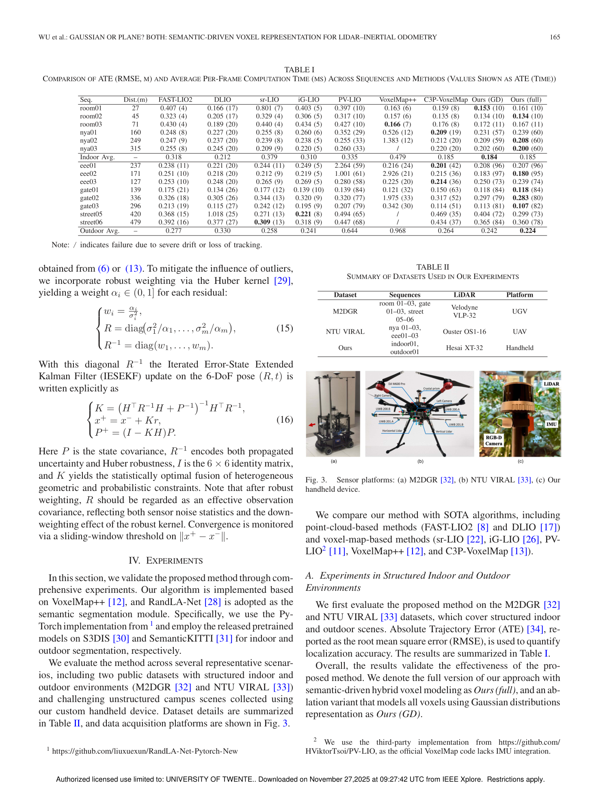

# Hybrid-VoxelMap

论文：[Hybrid-VoxelMap.pdf](../Hybrid-VoxelMap.pdf)。正式标题为 *Gaussian or Plane? Both: Semantic-Driven Voxel Representation for LiDAR-Inertial Odometry*，IEEE RA-L 2026。

## 背景和相关研究

单一平面体素在结构化墙面、地面等区域约束强，但在曲面、植被、稀疏点集或玻璃附近容易失配；单一 Gaussian 在非结构区域更稳健，却没有充分利用明确的平面几何。Hybrid-VoxelMap 进一步观察到，环境类别可以作为选择表示的高层先验：平面类别使用平面，非平面类别使用 Gaussian。

相关研究覆盖点云地图、surfel 地图、VoxelMap/VoxelMap++/C3P-VoxelMap，以及 NDT、LiTAMIN、LIO-GVM 等分布匹配。本文的区别是让语义分割直接影响体素类别和残差，而不只用于可视化或动态点后处理。

## 核心算法和推导

### 1) 语义驱动的体素分类

每帧用 RandLA-Net 生成点标签，并映射为两个 super-label：$L_{\mathrm{p}}=planar$、$L_{\mathrm{np}}=nonplanar$。固定边长 $S_{\mathrm{v}}$ 体素内点数超过 $N_{\mathrm{sem}}$ 后用多数投票确定类别：

$$
\begin{aligned}
L_{\mathrm{V}} &= \operatorname{majority\_vote}({l_{\mathrm{i}} | p_{\mathrm{i}} \in V})
\end{aligned}
$$

符号说明：$V$ 是体素，$p_i$ 是其中的点，$l_i$ 是点标签；$L_V$ 是多数票得到的体素类别，$S_v,N_{sem}$ 控制体素尺度和启动投票所需点数。

若为 planar 且协方差最小特征值 $\lambda_{\min} < \tau_{\mathrm{p}}$，拟合平面；若为 nonplanar 或平面拟合失败，保存 Gaussian。语义每 $W=50$ 帧低频刷新，同一空间体素的新语义可覆盖旧语义。

点集统计量为：

$$
\begin{aligned}
\mu = (1/n) \sum_i p_{\mathrm{i}} \\
\Sigma = (1/n) \sum_i (p_{\mathrm{i}}-\mu)(p_{\mathrm{i}}-\mu)^\top
\end{aligned}
$$

符号说明：$n$ 是体素内点数，$\mu$ 是点均值，$\Sigma$ 描述点的空间散布；$s,S$ 是增量维护的坐标和外积累加量。

增量地图只更新 $n, s=\sum p_{\mathrm{i}}, S=\sum p_{\mathrm{i}} p_{\mathrm{i}}^{\mathrm{T}}$，再恢复 $\mu=s/n$、$\Sigma=S/n-\mu \mu^{\mathrm{T}}$。平面体素还做特征分解并与六邻居做共面合并。

### 2) 平面残差

平面用 3-DoF 参数 `(a,b,d)`，固定法向第三分量为 1：$\omega=(a,b,1)$，$n=\omega/\lVert \omega \rVert$。对机体点 $p_{\mathrm{b}}$、世界点 $p_{\mathrm{w}}=R p_{\mathrm{b}}+t$，残差为：

$$
\begin{aligned}
r_{\mathrm{PL}} &= - (p_{\mathrm{w}}^\top \omega + d) / \lVert \omega \rVert
\end{aligned}
$$

符号说明：$p_b$ 是机体系点，$p_w=Rp_b+t$ 是世界系点，$\omega$ 是未归一化平面法向参数，$d$ 是平面偏置；$r_{PL}$ 是带符号点面距离。

状态 Jacobian：

$$
\begin{aligned}
H &= [([p_{\mathrm{b}}]_\times R^\top n)^\top, -n^\top]
\end{aligned}
$$

符号说明：$H$ 是对旋转和平移增量的残差 Jacobian，$n$ 是单位法向；$[p_b]_\times$ 表示由点坐标构成的反对称叉乘矩阵。

残差方差把 LiDAR 点噪声和局部平面参数协方差相加：

$$
\begin{aligned}
\sigma_{\mathrm{PL}}^{2} = J_{\mathrm{p}} \Sigma_{\mathrm{L}} J_{\mathrm{p}}^\top + J_{\mathrm{pl}} \Sigma_{\mathrm{pl}} J_{\mathrm{pl}}^\top
\end{aligned}
$$

符号说明：$J_p,J_{pl}$ 分别是残差对 LiDAR 点和平面参数的 Jacobian，$\Sigma_L,\Sigma_{pl}$ 是对应协方差；$\sigma_{PL}^2$ 是传播后的残差方差。

### 3) Gaussian 残差和统一 IESEKF

非平面体素使用缩放 Mahalanobis 距离：

$$
\begin{aligned}
r_{\mathrm{GD}} &= -\sigma_{\mathrm{avg}} \sqrt{(p_{\mathrm{w}}-\mu)^\top \Sigma^{-1}(p_{\mathrm{w}}-\mu)} \\
\sigma_{\mathrm{avg}} = \sqrt{\operatorname{tr}(\Sigma)/3}
\end{aligned}
$$

符号说明：$\mu,\Sigma$ 是 Gaussian 体素的均值和协方差，$\operatorname{tr}$ 表示矩阵迹；$r_{GD}$ 是缩放后的 Mahalanobis 距离，$\sigma_{avg}$ 将它换到距离量纲。

$\sigma_{\mathrm{avg}}$ 使 Gaussian 残差量纲和点到平面距离接近。均值协方差为 $\Sigma_{\mu}=\Sigma/n$，点和均值的 Jacobian 分别传播到残差方差 $\sigma_{\mathrm{GD}}^{2}$。

将两种标量残差堆叠，使用 Huber 权重 $\alpha_{\mathrm{i}}$：

$$
\begin{aligned}
w_{\mathrm{i}} &= \alpha_{\mathrm{i}} / \sigma_{\mathrm{i}}^{2} \\
K &= (H^\top \mathbb{R}^{-1} H + P^{-1})^{-1} H^\top \mathbb{R}^{-1} \\
x+ &= x- + K r \\
P+ &= (I-KH)P
\end{aligned}
$$

符号说明：$\sigma_i$ 是第 $i$ 个残差的标准差，$\alpha_i$ 是鲁棒权重，$w_i$ 是合成测量权重；$K$ 为滤波增益，$x^-,P$ 与 $x^+,P^+$ 分别表示更新前后状态和协方差。

所以平面区域保留精确法向约束，非平面区域则通过分布形状获得鲁棒约束，二者在一个 IESEKF 更新中融合。

## 实验流程和结果

实验使用 M2DGR、NTU VIRAL 和自采 handheld 数据，比较 FAST-LIO2、DLIO、sr-LIO、iG-LIO、PV-LIO2、VoxelMap++、C3P-VoxelMap；RandLA-Net 与里程计线程并行，平面/非平面模型分别记为 Ours(full) 和 Ours(GD，全 Gaussian)。

Table I 的场景平均 ATE（m，括号为平均每帧时间 ms）中：

| 场景 | C3P-VoxelMap | Ours(GD) | Ours(full) |
| --- | ---: | ---: | ---: |
| Indoor Avg. | 0.185 | 0.184 | 0.185 |
| Outdoor Avg. | 0.264 | 0.242 | **0.224** |

自采数据 Table III 的端到端误差：

| 方法 | indoor01 total | outdoor01 total |
| --- | ---: | ---: |
| FAST-LIO2 | 9.48 | 失败 |
| DLIO | 1.29 | 34.24 |
| PV-LIO | 0.04 | 22.99 |
| C3P-VoxelMap | 17.58 | 40.79 |
| Ours(GD) | 0.06 | 22.26 |
| Ours(full) | 0.06 | **20.96** |

自采 outdoor01 含植被、玻璃幕墙和大面积开放区域；完整方法在 Z 方向改善最明显。玻璃反射在 Fig. 5 中形成孔洞和伪点，但语义区分和 Gaussian fallback 仍生成结构连续的地图。运行时间在所有序列低于 `100 ms`；RandLA-Net 单次推理小于 `400 ms`、每 5 帧运行一次并行线程。内存方面，方法本身与点云方法相近，但仍需额外约 `4.6 GB RAM/1.6-2.0 GB GPU` 的 RandLA-Net 运行资源（Table IV，取决于配置）。

## 总结

Hybrid-VoxelMap 的价值在于“表示选择”和“残差选择”同时由场景信息驱动。它揭示了平面地图和 Gaussian 地图并非互斥，但语义网络会成为新的系统依赖：误分类会改变残差模型，且本文的 segmentation 资源和端到端延迟需要单独核验。

---

## 2026-11-15 对 PV-LIO-PLUS 的范围说明

- 作者 ROS1 源码已收集且共享构建通过；Hybrid-VoxelMap 是条件化的地图与对应观测设计候选，尚未接入 PV selector。移植须保留论文提出的语义地图层级结构。
- 可评估语义驱动平面/Gaussian 表示及 Plane/NDT 匹配；须补标签来源、缺失/错帧语义、类别转换、协方差退化与两类观测的独立 Jacobian/权重。
- 无语义的 Gaussian 路径须另命名，不代表完整算法；语义网络输入及计算与地图/残差适配分档记录。
