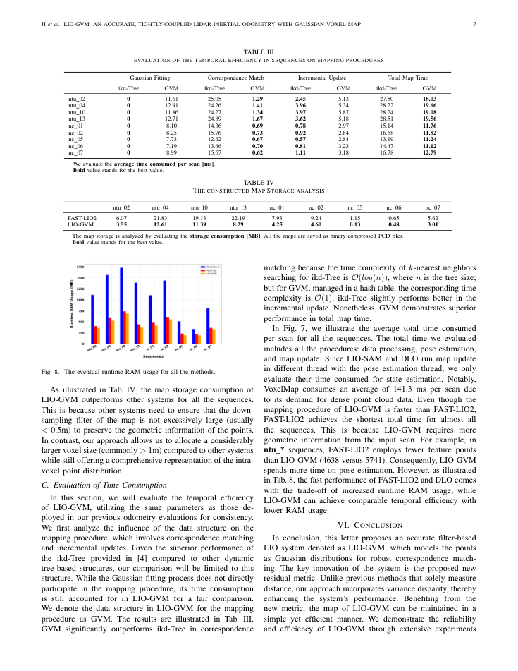

# LIO-GVM

论文：[LIO-GVM.pdf](../LIO-GVM.pdf)。标题为 *LIO-GVM: An Accurate, Tightly-Coupled Lidar-Inertial Odometry with Gaussian Voxel Map*。

## 背景和相关研究

最近点或点到平面匹配通常只使用几何距离，无法直接表示源点和目标点的协方差，也难以从候选中拒绝“距离近但分布不相似”的错误对应。kd-tree 的查询与维护还会随地图规模增长；部分体素方法虽然有 `O(1)` 哈希访问，但仍需嵌套点结构。

LIO-GVM 用一个 Gaussian 表示每个源/目标局部点集，把“位置差”和“分布形状差”同时用于关联与残差；全局地图只保留每个体素的均值、协方差和计数。

## 核心算法和推导

### 1) IMU 预测和源分布

状态在 $SO(3) \times R^{15}$ 上用误差状态传播。离散传播可写为：

$$
\begin{aligned}
x_{i+1} &= x_{\mathrm{i}} \boxplus f(x_{\mathrm{i}},u_{\mathrm{i}},w_{\mathrm{i}}) \\
P_{i+1} &= F_{\mathrm{x}} P_{\mathrm{i}} F_{\mathrm{x}}^\top + F_{\mathrm{w}} W F_{\mathrm{w}}^\top
\end{aligned}
$$

符号说明：$x_i,P_i$ 是 IMU 状态及其协方差，$f$ 是离散传播模型，$u_i,w_i$ 分别代表输入和过程噪声；$F_x,F_w$ 是相应 Jacobian，$W$ 是过程噪声协方差，$\boxplus$ 表示流形状态更新。

扫描去畸变后，对每个源点及其邻域拟合 Gaussian：

$$
\begin{aligned}
L_{\mathrm{k}} p_{\mathrm{j}} \sim N(L_{\mathrm{k}} \mu_{\mathrm{j}}, L_{\mathrm{k}} C_{\mathrm{j}})
\end{aligned}
$$

符号说明：$\mu_j,C_j$ 是第 $j$ 个源 Gaussian 的均值和协方差；$L_k,G$ 标记扫描局部系和全局系，$T_{Lk},R_{Lk}$ 是当前位姿的平移和旋转部分，帽号表示变换后的分布。

用当前迭代位姿投影到全局：

$$
\begin{aligned}
G \mu_{\mathrm{hat,j}} &= G T_{\mathrm{Lk}} L_{\mathrm{k}} \mu_{\mathrm{j}} \\
G C_{\mathrm{hat,j}} &= G R_{\mathrm{Lk}} L_{\mathrm{k}} C_{\mathrm{j}} G R_{\mathrm{Lk}}^\top
\end{aligned}
$$

### 2) Hellinger 相似度筛错

源 Gaussian 与候选目标 Gaussian 的相似度取平方 Hellinger 距离中的相似项：

$$
\begin{aligned}
s_{j,i} &= sqrt( (\det C_{\mathrm{j}} \det C_{\mathrm{i}})^{1/2} \\
/ \det(C_{\mathrm{j}}/2 + C_{\mathrm{i}}/2) )
\end{aligned}
$$

符号说明：$s_{j,i}$ 衡量源分布 $j$ 与目标分布 $i$ 的相似程度，$C_j,C_i$ 是它们的协方差，$\det$ 表示行列式；$s_t$ 是筛选阈值。

$s$ 越大表示协方差形状越接近。查询源均值所在体素及其 7 邻域，只保留 $s \ge s_{\mathrm{t}}$ 的候选；噪声越大时阈值应放宽。

### 3) 相似度加权的分布到分布残差

论文用加权 Mahalanobis 距离：

$$
\begin{aligned}
J &= \sum_j s_{\mathrm{j}}^{2} (\mu_{\mathrm{hat,j}} - \mu_{\mathrm{i}})^\top \\
(C_{\mathrm{hat,j}} + C_{\mathrm{i}} + \alpha I)^{-1} \\
(\mu_{\mathrm{hat,j}} - \mu_{\mathrm{i}})
\end{aligned}
$$

符号说明：$J$ 是所有匹配项的加权代价，$\mu_{hat,j}-\mu_i$ 是两分布均值差，$s_j$ 是相似度，$\alpha I$ 用于稳定求逆；$D_j$ 是合并协方差逆平方根，$z_j$ 是白化并加权后的向量残差。

令 $D_{\mathrm{j}}=(C_{\mathrm{hat}}_j+C_{\mathrm{i}}+\alpha I)^(-1/2)$，单个向量残差为

$$
\begin{aligned}
z_{\mathrm{j}} &= s_{\mathrm{j}} D_{\mathrm{j}} (\mu_{\mathrm{hat,j}} - \mu_{\mathrm{i}})
\end{aligned}
$$

它同时做到三点：距离远的对应不可信，协方差差异大的对应被抑制，相似度高的对应权重大。其对误差状态的 Jacobian 具有典型的“旋转-平移-其余状态”结构：

$$
\begin{aligned}
H_{\mathrm{j}} &= [-s_{\mathrm{j}} D_{\mathrm{j}} [I, q_{\mathrm{j}}]_\times,  s_{\mathrm{j}} D_{\mathrm{j}},  0_{3\times 15}]
\end{aligned}
$$

符号说明：$H_j$ 是残差对 18 维误差状态的 Jacobian；前两块对应旋转和平移，$q_j$ 是叉乘块中的位置向量，$0_{3\times15}$ 表示其余状态分量的直接导数为零。

所有残差叠加后，使用 IESKF/MAP 更新。$\alpha I$ 用于避免协方差奇异。

### 4) 仅 Gaussian 的体素地图

全局哈希地图为 $Z^{3} \to (\mu,C)$。当前扫描先临时体素化得到 $(\mu_{\mathrm{bar}},C_{\mathrm{bar}},N)$；若体素不存在则插入，否则按点数融合：

$$
\begin{aligned}
\mu = (M \mu + N \mu_{\mathrm{bar}})/(M+N) \\
C &= (M C + N C_{\mathrm{bar}})/(M+N)
\end{aligned}
$$

符号说明：$(\mu,C)$ 是已有地图 Gaussian，$(\mu_{bar},C_{bar})$ 是当前扫描统计量，$M,N$ 是二者各自的点数；合并后仍以均值和协方差保存体素。

论文还将更新后的 $M$ 限制为 $\max(M,N)$，避免历史权重无限增大，使远处或早期错误状态造成的统计量永久“冻结”。

## 实验流程和结果

实验使用 Newer College 的 OS1-64，以及 MCD VIRAL 的 OS1-128、Mid-70 和不同 IMU 配置；平台为 Ryzen 7 6800H、16 GB。体素边长 `1.0 m`，相似度阈值 $s_{\mathrm{t}}=0.70$，$\alpha=1e-6$，搜索 7 邻域。对比 DLO、VoxelMap、LIO-SAM、FAST-LIO2，并做 `w/o s` 和 `plane` 消融。

关键 ATE/ARE（Table II，格式为 ATE[%]/ARE[deg/10m]）：

| 序列 | FAST-LIO2 | LIO-GVM(w/o s) | LIO-GVM(plane) | LIO-GVM |
| --- | ---: | ---: | ---: | ---: |
| ntu02 | 2.09/0.24 | 2.37/0.40 | 8.24/0.68 | **1.74/0.46** |
| ntu04 | 2.11/0.13 | 2.35/0.11 | 6.91/0.41 | **2.26/0.05** |
| ntu13 | 2.89/0.11 | 2.79/0.14 | 5.77/0.43 | **2.74/0.09** |
| ntuo04 | 3.51/0.23 | 4.73/0.39 | 7.95/0.54 | **2.69/0.14** |
| nc06 | 0.94/0.37 | 1.28/0.43 | 2.48/0.59 | **0.89/0.33** |

论文结论是 LIO-GVM 在大多数序列中最好；`plane` 消融明显变差，说明“只用距离、不看分布相似性”会把低质量对应同等送入估计。VoxelMap 在 64 线序列上多次发散，作者将其关联到远处体素过早收敛和地面采样不足。

时间和存储（Tables III-IV）：

- Gaussian fitting 约 `7.19-12.91 ms/scan`，但 Gaussian 方案的 hash correspondence match 约 `0.57-1.67 ms`，总地图时间 `11.12-19.66 ms`，低于 ikd-Tree 的 `11.24-28.51 ms` 区间中的多数情况。
- LIO-GVM 存储在 ntu02/ntu04/ntu13/nc01 上为 `3.55/12.61/8.29/4.25 MB`，FAST-LIO2 为 `6.07/21.83/22.19/7.93 MB`。

关键图表：第 4 页 Fig. 3 示意“最近点但分布不相似”的错配；第 6 页 Fig. 5/6 展示低成本 IMU和大高程变化下的轨迹；第 7 页 Fig. 7/8 分别是时间和运行时内存。

## 总结

LIO-GVM 把概率信息用于两个环节：先用 Gaussian 相似度做数据关联，再用带协方差的分布到分布残差做状态更新。它适合验证 PV-LIO-PLUS 中“概率平面不确定性”和“候选关联置信度”能否分开建模，而不是仅把所有匹配点看成同方差观测。

---

## 2026-11-15 对 PV-LIO-PLUS 的范围说明

- `upstream/lio_gvm` 已收集，但作者发布缺少定制 Fast-VGICP、IKFoM 和地图头文件，现有独立构建以退出码 1 阻塞；当前尚不能完成观测核验或集成。
- 保留候选须实现其 Gaussian 地图结构及配套分布观测，不能只用通用点容器代表 LIO-GVM。完整源码恢复后再检查均值/协方差、退化、信息映射及状态 Jacobian。
- 不用通用依赖替代作者定制接口，也不把残差降成点面以绕开缺口。当前没有此后端 selector 或精度复现。
