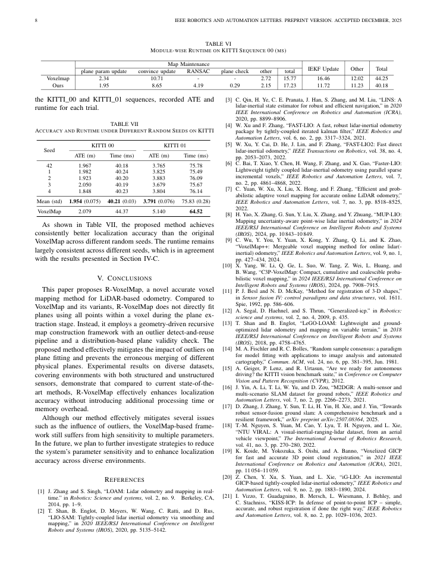

# R-VoxelMap

论文：[R-VoxelMap.pdf](../R-VoxelMap.pdf)。标题为 *R-VoxelMap: Accurate Voxel Mapping with Recursive Plane Fitting for Online LiDAR Odometry*（arXiv:2601.12377）。

## 背景和相关研究

传统 VoxelMap 在一个体素内直接对全部点 PCA，离群点会改变法向和中心；若收紧阈值，又容易把同一个物理平面过分割。RANSAC 能去除离群点，但可能把两个法向相近而空间分离的平面合成一个平面，造成空白区域被错误地解释为平面。

R-VoxelMap 的核心是“找出一个可信平面后，把其余点保留下来继续细分”，并通过平面内二维分布检查阻止错误合并。

## 核心算法和推导

### 1) 递归平面构造

世界点和协方差首先由位姿、LiDAR 点及其不确定性传播得到：

$$
\begin{aligned}
W p_{\mathrm{i}} &= W R_{\mathrm{L}} L p_{\mathrm{i}} + W t_{\mathrm{L}} \\
\Sigma_{\mathrm{Wpi}} = W R_{\mathrm{L}} \Sigma_{\mathrm{Lpi}} W R_{\mathrm{L}}^\top \\
+ W R_{\mathrm{L}} [L p_{\mathrm{i}}]_\times \Sigma_{\mathrm{R}} [L p_{\mathrm{i}}]_\times^\top W R_{\mathrm{L}}^\top \\
+ \Sigma_{\mathrm{t}}
\end{aligned}
$$

对当前节点点集 $P_{\mathrm{in}}$ 做 RANSAC，得内点 $I$ 和离群点 $O$。若 $\lvert I \rvert/\lvert P_{\mathrm{in}} \rvert > p_{\mathrm{th}}$，对 $I$ 求：

$$
\begin{aligned}
q &= \operatorname{mean}(I) \\
A &= \operatorname{mean}(p_{\mathrm{i}} p_{\mathrm{i}}^\top) - q q^\top \\
n &= \operatorname{eigenvector}(A, \lambda_{\min})
\end{aligned}
$$

当最小特征值满足平面阈值后，执行平面有效性检查。有效点形成当前节点的概率平面；其余点 $O$ 被放入八叉树子节点递归处理，直到所有点被解释或达到最大深度。与只在叶节点保存特征的结构不同，R-VoxelMap 允许任意八叉树节点保存点和平面。

### 2) 平面有效性检查

取 RANSAC 平面的两个主方向 $u_{\mathrm{1}},u_{\mathrm{2}}$，把内点投影到平面并按二维网格量化：

$$
\begin{aligned}
(x_{\mathrm{i}},y_{\mathrm{i}}) &= ( \operatorname{floor}((p_{\mathrm{i}}-q)^\top u_{\mathrm{1}}/r), \\
\operatorname{floor}((p_{\mathrm{i}}-q)^\top u_{\mathrm{2}}/r) )
\end{aligned}
$$

对占用网格做 4-邻接 DFS/区域生长，选点数最多的连通簇 $I_{\mathrm{best}}$。只有当 $\lvert I_{\mathrm{best}} \rvert/\lvert P_{\mathrm{in}} \rvert > p_{\mathrm{th}}$ 时，才用该簇重拟合平面；否则整个节点的点都继续递归。这个步骤拒绝两个相邻但不连续物理平面被拟合成一个无限平面。

### 3) 增量更新、重建和概率匹配

对已有平面用充分统计量递推：

$$
\begin{aligned}
q \leftarrow N/(N+1) q + p_{\mathrm{new}}/(N+1) \\
S \leftarrow S + p_{\mathrm{new}} p_{\mathrm{new}}^\top \\
A \leftarrow S/(N+1) - q q^\top
\end{aligned}
$$

若更新后最小特征值仍满足阈值，则吸收点；否则暂存在叶节点的非平面点集中，等待周期性八叉树重建。重建利用链表拼接复用点，不复制大向量；低分辨率体素用 LRU 控制大范围地图的内存。

对候选平面 $i$，点到平面距离为 $d_{\mathrm{i}}=n_{\mathrm{i}}^{\mathrm{T}}(Wp_{\mathrm{i}}-q_{\mathrm{i}})$，联合点和面参数不确定性得到：

$$
\begin{aligned}
\sigma_{\mathrm{i}}^{2} = J_{\mathrm{w}} [ \Sigma_{\mathrm{nq}}  0; 0  \Sigma_{\mathrm{Wpi}} ] J_{\mathrm{w}}^\top \\
J_{\mathrm{w}} &= [ (Wp_i-q_{\mathrm{i}})^\top, -n_{\mathrm{i}}^\top, n_{\mathrm{i}}^\top ]
\end{aligned}
$$

进一步以

$$
\begin{aligned}
p_{\mathrm{i}} &= 1/(\sigma_{\mathrm{i}} \sqrt{2 \pi}) \exp(-d_{\mathrm{i}}^{2}/(2 \sigma_{\mathrm{i}}^{2}))
\end{aligned}
$$

作为对应概率，在距离阈值内选概率最大的平面送入 MAP/IEKF。

## 实验流程和结果

数据包括 KITTI、M2DGR、M3DGR 走廊、NTU VIRAL 和自采 AVIA；统一普通场景 `0.5 m + 3` 次迭代，退化走廊 `0.1 m + 5` 次，最大体素 3 m，最大八叉树层数 4，平台为 i9-13900HX、32 GB。

KITTI ATE（Table II）：

| 方法 | 平均 ATE（m） | KITTI 00 | KITTI 01 | KITTI 02 |
| --- | ---: | ---: | ---: | ---: |
| Fast-GICP | 9.237 | 6.023 | 76.751 | 14.003 |
| KISS-ICP | 4.598 | 4.284 | 20.182 | 7.668 |
| FAST-LIO2 | 4.698 | 3.666 | 19.583 | 9.047 |
| VoxelMap | 3.304 | 2.079 | 5.140 | 9.789 |
| R-VoxelMap（无有效性检查） | 2.574 | 2.022 | 3.624 | 6.025 |
| R-VoxelMap（完整） | **2.570** | **1.967** | 3.764 | **5.912** |

M2DGR/NTU 的 `street01, street02, street03, street04, spms03` 上，完整方法为 `0.274, 2.061, 0.130, 0.355, 0.206 m`；对应 VoxelMap 为 `0.352, 2.516, 0.133, 1.273, 0.215 m`。M3DGR 走廊 `corr1/corr2` 的端到端误差为 `1.036/2.518 m`，VoxelMap 为 `6.104/14.630 m`。

KITTI 00 模块时间（Table VI）总计 R-VoxelMap `40.18 ms`，VoxelMap `44.25 ms`；R-VoxelMap 的额外 RANSAC 为 `4.19 ms`，但平面参数更新和 IEKF 分别为 `1.95/11.72 ms`，低于 VoxelMap 的 `2.34/16.46 ms`。5 个随机种子下 KITTI 00 ATE 为 `1.954 +/- 0.075 m`，时间 `40.21 +/- 0.03 ms`，说明随机性在该实验中可控。

关键图表：第 1/3 页 Fig. 1/3 展示离群点、过分割和误合并的几何问题；第 4-5 页 Fig. 4 给出平面投影、二维连通簇和重拟合；第 7 页 Fig. 5 展示走廊和 AVIA 的地图对比。

## 总结

R-VoxelMap 的贡献是把“平面拟合”和“剩余点重用”连成递归流程，同时检查平面点在二维支持域中是否真的连通。对 PV-LIO-PLUS，若要引入 RANSAC，应同时保留未被当前平面解释的点，并避免仅用最小特征值判断一个大空间平面是否真实存在。

---
