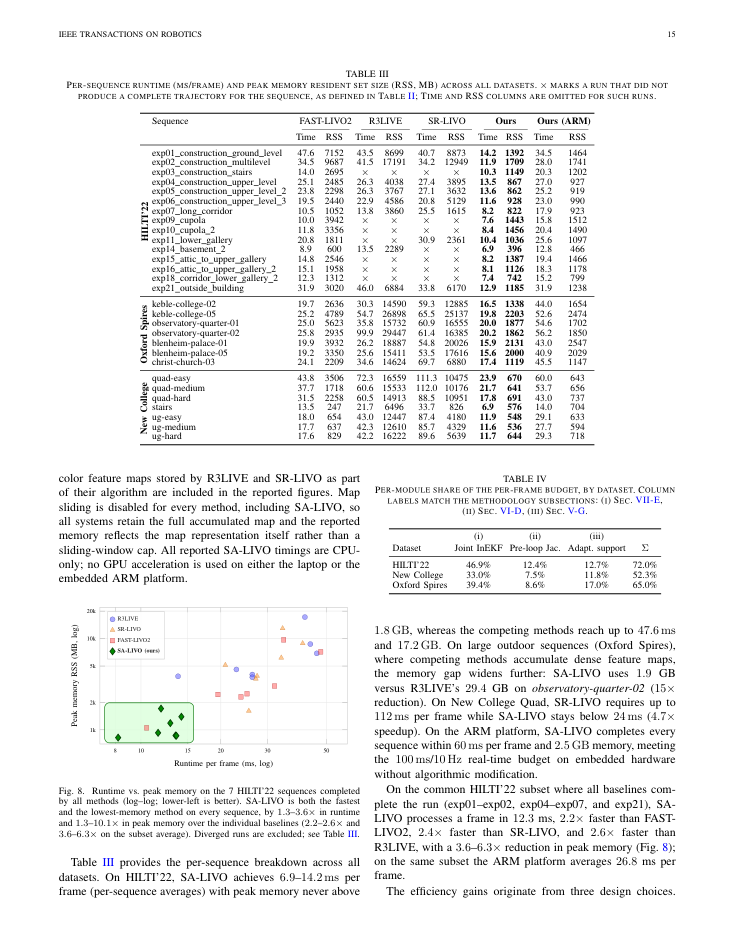

# SA-LIVO

论文：[`SA-LIVO.pdf`](../SA-LIVO.pdf)，题目为 *SA-LIVO: Efficient LiDAR-Inertial-Visual Odometry with Subspace-Aware Degeneracy Handling*。

## 背景和相关研究

LiDAR 在走廊、隧道、平面墙面等环境中会出现几何退化；视觉在暗光、运动模糊和低纹理场景中也会失效。常见的“整块关闭某一传感器”策略没有利用退化只发生在部分状态方向这一事实，可能丢掉仍然可靠的互补约束。SA-LIVO 的目标是把 LiDAR、视觉的退化判断统一到信息矩阵的子空间中。

## 核心算法和推导

**LiDAR 约束。** LiDAR 点先变换到 IMU 和世界系：

$$
\begin{aligned}
p_{\mathrm{I}} &= R_{\mathrm{LI}} p_{\mathrm{b}} + p_{\mathrm{LI}} \\
p_{\mathrm{w}} &= R p_{\mathrm{I}} + p
\end{aligned}
$$

局部平面用中心 $p_{\mathrm{bar}}$、法向 $n$ 和最小特征值描述，点到平面残差为：

$$
\begin{aligned}
r_{\mathrm{i}} &= n_{\mathrm{i}}^\top p_{\mathrm{w}} + d_{\mathrm{i}}
\end{aligned}
$$

右扰动下，外参已知时的 6-DoF 位姿 Jacobian 写成：

$$
\begin{aligned}
h_i &=
\begin{bmatrix}
[R p_I]_\times n_i\\
n_i
\end{bmatrix}
\end{aligned}
$$

论文用无量纲的平面可观测性指标筛选平面：

$$
\begin{aligned}
\kappa = \lambda_{\min} / \operatorname{tr}(\Sigma_{\mathrm{pts}})
\end{aligned}
$$

当 $\kappa < 0.05$ 时接受为平面。邻域搜索采用自适应 Chebyshev 壳层，最多取 25 个点；同时根据 LiDAR 的距离、入射角和离散化误差构造点噪声。平面协方差近似为 $\lambda_{\min} / N_{\mathrm{eff}} * I_{\mathrm{6}}$，从而形成 LiDAR 信息：

$$
\begin{aligned}
\Lambda_{\mathrm{L}} = \sum_i (1 / \sigma_{\mathrm{i}}^{2}) h_{\mathrm{i}}^\top h_{\mathrm{i}} \\
b_{\mathrm{L}} &= -\sum_i (1 / \sigma_{\mathrm{i}}^{2}) h_{\mathrm{i}}^\top r_{\mathrm{i}}
\end{aligned}
$$

**视觉约束。** 视觉使用 LiDAR 提供的深度锚点进行直接法 patch 光度残差。深度相关噪声、梯度和 patch 质量会影响权重；Jacobian 在一次 InEKF 迭代开始前冻结，避免迭代期间重复计算。5 帧滑窗中，重复使用同一 LiDAR 锚点时用 $w_{\mathrm{dec}} = 1 / n_{\mathrm{used}}$ 降低过度计数。质量因子由 RMS、有效 patch 数和拒绝比例组成：

$$
\begin{aligned}
q &= q_{\mathrm{rms}} q_{\mathrm{cnt}} q_{\mathrm{rej}} \\
\Lambda_{\mathrm{V}} = \sum_j w_{\mathrm{j}} J_{\mathrm{j}}^\top J_{\mathrm{j}} \\
b_{\mathrm{V}} &= -\sum_j w_{\mathrm{j}} J_{\mathrm{j}}^\top r_{\mathrm{j}}
\end{aligned}
$$

**SAIF 子空间融合。** LiDAR 和视觉信息先相加，再对 6-DoF 外部位姿块做特征分解：

$$
\begin{aligned}
\Lambda_{\Sigma} &= \Lambda_{\mathrm{L}} + q \Lambda_{\mathrm{V}} = U \operatorname{diag}(\lambda_{\mathrm{k}}) U^\top \\
b' &= U^\top (b_{\mathrm{L}} + q b_{\mathrm{V}}) \\
\gamma_{\mathrm{k}}    = \min(\sqrt{\lambda_{\mathrm{k}}} / \sigma_{\min}, 1) \\
\tilde{\lambda}_{k} &= \gamma_{\mathrm{k}} \lambda_{\mathrm{k}} \\
\tilde{b}'_{k} &= \gamma_{\mathrm{k}} b'_k \\
\Lambda_{\mathrm{f}}    = U \operatorname{diag}(\tilde{\lambda}_{k}) U^\top \\
b_{\mathrm{f}} &= U \tilde{b}'
\end{aligned}
$$

小特征值方向被连续衰减而不是整块清零；较强的方向保持原有信息。$\Lambda_{\mathrm{f}}$ 仍为半正定矩阵，因此可以直接送入 InEKF。算法只处理外部传感器的 6-DoF 位姿子块，不对完整 18 状态做无量纲混合；实现时必须注意平移和旋转信息量纲不同，$\sigma_{\min}$ 的设定不能脱离单位。

## 实验流程和结果

实验覆盖 HILTI’22、Newer College 和 Oxford Spires，共 29 个序列，并额外构造视觉或 LiDAR 退化场景；平台为 i9-13900HX 和 Jetson Orin，推理不使用 GPU。代表性 ATE（m）如下，数值为论文 Table II：

| 场景 | FAST-LIVO2 | SA-LIVO |
| --- | ---: | ---: |
| HILTI exp10 | 0.218 | **0.075** |
| HILTI exp15 | 0.192 | **0.122** |
| Newer College Quad Hard | 0.080 | **0.055** |
| Newer College Stairs | 0.057 | **0.036** |
| Oxford observatory-quarter-01 | 0.297 | **0.055** |

HILTI 的 15 个序列中，只有 SA-LIVO 和 FAST-LIVO2 完成全部序列；在共同成功子集上，SA-LIVO 平均约 12.3 ms/frame，论文报告约为 FAST-LIVO2 的 2.2 倍。Jetson Orin 上 SA-LIVO 平均约 26.8 ms/frame；峰值内存约为基线的 3.6--6.3 倍更低。Table III 给出 HILTI 各序列约 6.9--14.2 ms/frame 的耗时，Table IV 中联合 InEKF 更新耗时占比分别约为 HILTI 46.9%、Newer College 33.0%、Oxford 39.4%。第 5 页 Fig. 2 展示 SAIF 的信息椭球衰减，第 9 页 Fig. 5 对比退化场景轨迹，第 10 页 Fig. 9/10 展示子空间选择和运行时间。

## 总结

SA-LIVO 的关键贡献不是再设计一个视觉或 LiDAR 前端，而是把“传感器是否可靠”细化为“哪些状态方向可靠”。这比模态级开关更充分地利用互补信息，但实现必须维护信息矩阵的单位、块结构和数值稳定性；论文结果主要验证了所选数据集和平台，尚不能直接等价为所有传感器组合下的实时性。

---
