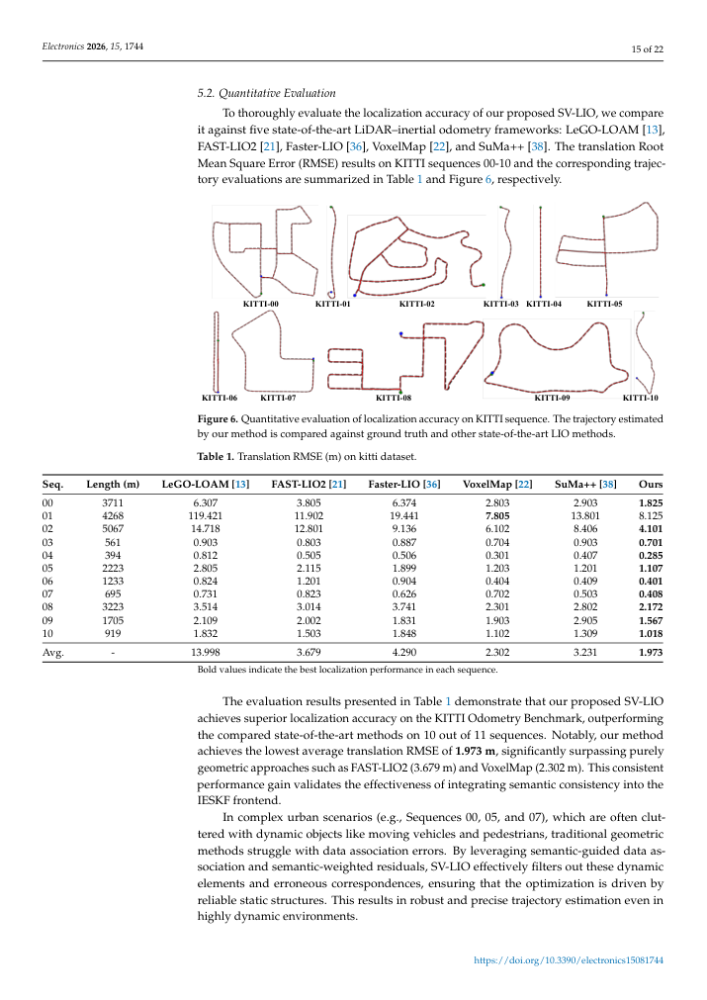

# SV-LIO

论文：[`SV-LIO.pdf`](../SV-LIO.pdf)，题目为 *SV-LIO: A Probabilistic Adaptive Semantic Voxel Map for LiDAR-Inertial Odometry*。

## 背景和相关研究

只依赖几何的体素地图容易受到动态物体、植被和重复结构影响；只把语义用于后端建图或动态点删除，也不能充分改善前端数据关联。SV-LIO 将语义类别概率直接放进体素表示、邻域关联和测量噪声，并用自适应几何阈值处理不同类别的形状差异。

## 核心算法和推导

**概率语义体素。** 每个体素维护点数、均值、协方差累加量和语义标签统计。由 PCA 得到最小特征向量 $n$ 作为局部平面法向；点到平面的投影为：

$$
\begin{aligned}
q_{\mathrm{i}} &= (I - n n^\top) (p_{\mathrm{i}} - p_{\mathrm{bar}})
\end{aligned}
$$

对主导类别使用更宽松或更严格的几何阈值，点不满足平面约束时按投影方向推入对应八叉树子象限。几何不确定度由最小特征值的平方根给出：

$$
\begin{aligned}
\sigma' = \sqrt{\lambda'_{\min}}
\end{aligned}
$$

体素还保存最大投影尺度 $\sigma_{\max}$ 和主导标签概率：

$$
\begin{aligned}
P(l_{\mathrm{dom}} | V) &= N(l_{\mathrm{dom}}) / N(V)
\end{aligned}
$$

因此地图同时回答“这里是什么”和“这里是否足够平”。根体素边长 1 m，继续递归细分到最大深度 3；新点通过运行统计量递推更新均值和协方差，避免保存全部历史点。

**语义引导关联。** 当前点先变换到世界系：

$$
\begin{aligned}
p_{\mathrm{i}}^{w} &= R_{\mathrm{k}} p_{\mathrm{i}} + t_{\mathrm{k}}
\end{aligned}
$$

对候选体素按语义兼容性和几何距离选择：

$$
\begin{aligned}
j* &= \operatorname*{arg\,\max}_{j} P(l_{\mathrm{i}} | V_{\mathrm{j}}) / (d_{\mathrm{geo}} + \epsilon)
\end{aligned}
$$

若点标签与体素主导标签冲突，则该候选的兼容性置零；这样可减少相邻但属于不同物体的错误匹配。

**残差和滤波。** 匹配到体素后使用点到平面残差：

$$
\begin{aligned}
r_{\mathrm{i}} &= n^\top (R p_{\mathrm{i}} + t - p_{\mathrm{bar}})
\end{aligned}
$$

其测量协方差按语义概率放大或缩小：

$$
\begin{aligned}
\Sigma_{\mathrm{L}} = \sigma_{\mathrm{sensor}}^{2} / P(l_{\mathrm{i}} | V*)
\end{aligned}
$$

右扰动误差状态下，位姿部分 Jacobian 为：

$$
\begin{aligned}
H_{\mathrm{i}} &= [-n^\top R [p_{\mathrm{i}}]_\times, n^\top, 0]
\end{aligned}
$$

所有匹配残差组成 IESKF 的 MAP 更新；语义不是额外的离散后处理，而是同时影响关联概率、残差权重和地图更新。

## 实验流程和结果

实验使用 KITTI 00--10 和 MulRan 九个序列；KITTI 采用 HDL-64E/OXTS，IMU 频率 100 Hz。平台为 i9、32 GB；参数为根体素 1 m、最大深度 3、平面特征值阈值 0.001，语义几何阈值为 0.2/0.05。语义标签为离线输入，因此报告的运行时间不包含语义推理。

KITTI 平均平移误差（Table 1，%）为：

| 方法 | 平均误差 |
| --- | ---: |
| FAST-LIO2 | 3.679 |
| VoxelMap | 2.302 |
| SuMa++ | 3.231 |
| SV-LIO | **1.973** |

代表性序列中，SV-LIO 在 00/01/02/07 上分别为 1.825、8.125、4.101、0.408。MulRan 平均结果为 SV-LIO 2.54、VoxelMap 3.23、FAST-LIO2 5.32、Faster-LIO 5.40。KITTI 消融 Table 3 的平均误差如下：

| 配置 | 平均误差 |
| --- | ---: |
| 去掉语义信息 | 3.199 |
| 去掉语义引导关联 | 2.515 |
| 去掉语义加权 | 2.222 |
| 完整 SV-LIO | **1.973** |

从结果看，语义关联和语义加权均有贡献，完整版本优于只做语义删除或只做几何关联。平均耗时约 44.4 ms/frame（约 22.5 Hz），其中下采样 5.4 ms、残差计算 21.2 ms、Kalman 更新 2.1 ms、地图更新 15.7 ms。第 3 页 Fig. 1 展示语义概率体素的流程，第 7 页 Fig. 4/5 对比 KITTI 轨迹和局部地图，第 10 页 Fig. 6 展示 MulRan 结果。

## 总结

SV-LIO 把语义从“过滤动态点”推进到“概率地图 + 关联 + 噪声模型”一体化处理，核心收益来自减少跨物体误匹配并对不可靠类别降权。主要限制是语义标签离线提供，论文没有证明端到端语义推理仍能保持所报频率；跨天气、跨域和标签错误传播也需要额外验证。

---

## 2026-11-14 地图替换边界

- 范围审查将 SV-LIO 移出直接候选：语义类别概率参与体素表示、数据关联及残差加权，实验标签为离线生成。
- 去掉语义后剩余几何层属于 VoxelMap 派生物，必须另命名，不能继续宣称复现 SV-LIO。
- 语义关联和加权残差都超出本轮固定点面观测边界；论文端到端语义推理速度也不能由离线标签实验推定。
- 详见[范围审查](MAP_BACKEND_SCOPE_REVIEW.md)。本文只记录论文方法和作者结果。
