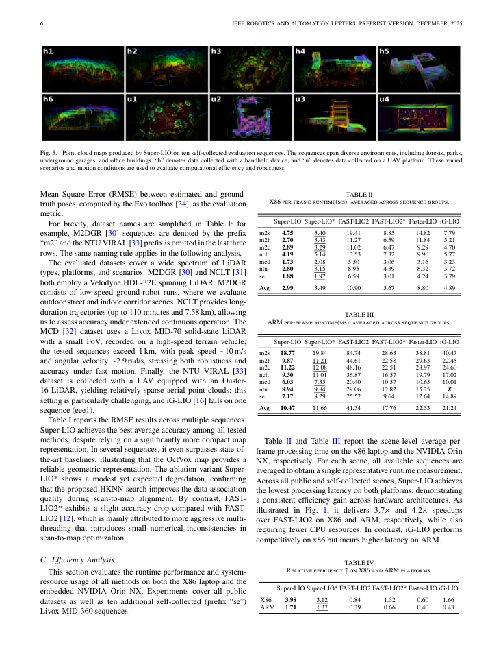

# Super-LIO

论文：[Super-LIO.pdf](../Super-LIO.pdf)。标题为 *Super-LIO: A Robust and Efficient LiDAR-Inertial Odometry System with a Compact Mapping Strategy*。

## 背景和相关研究

FAST-LIO2 的 ikd-Tree 在地图维护和 KNN 上有较好表现，但查询仍有 `O(log N)` 代价。Faster-LIO 的 iVox 访问体素是 `O(1)`，却通常需要访问 7-27 个邻域体素并重新做 PCA。IEKF 每帧迭代多次，同一批邻域被反复搜索和拟合，因此 KNN 与平面拟合成为主要瓶颈。

Super-LIO 将表示和搜索同时改造：OctVox 限制每个体素内的代表点数量，HKNN 利用规则的子体素顺序提前生成搜索优先级。

## 核心算法和推导

### 1) 误差状态和去畸变

状态为

$$
\begin{aligned}
X &= [R_{\mathrm{I}}^{G}, p_{\mathrm{I}}^{G}, v_{\mathrm{I}}^{G}, b_{\mathrm{a}}, b_{\mathrm{g}}, g]^\top \\
\in \mathrm{SO}(3) \times \mathbb{R}^{15}
\end{aligned}
$$

符号说明：$R_I^G,p_I^G,v_I^G$ 是 IMU 在世界系中的姿态、位置和速度，$b_a,b_g$ 是加速度计与陀螺仪偏置，$g$ 是重力；其余 15 维由非旋转状态组成。

IMU 以中值积分传播。锚定在扫描末时刻 $t_{\mathrm{k}}$ 的点先去畸变到 $I_{\mathrm{k}}$：

$$
\begin{aligned}
p_{\mathrm{i}}^{I_{\mathrm{k}}} &= R_{I_{\mathrm{i}}}^{I_{\mathrm{k}}} (R_{\mathrm{L}}^{I} p_{\mathrm{i}}^{L} + p_{\mathrm{L}}^{I}) + p_{I_{\mathrm{i}}}^{I_{\mathrm{k}}}
\end{aligned}
$$

符号说明：$p_i^L$ 是 LiDAR 系扫描点，$R_L^I,p_L^I$ 是 LiDAR 到 IMU 的外参；$R_{I_i}^{I_k},p_{I_i}^{I_k}$ 将点从采样时刻变换到扫描末端时刻的 IMU 系。

再用当前状态变换到全局：

$$
\begin{aligned}
p_{\mathrm{i}}^{G} &= R_{\mathrm{I}}^{G}(t_{\mathrm{k}}) p_{\mathrm{i}}^{I_{\mathrm{k}}} + p_{\mathrm{I}}^{G}(t_{\mathrm{k}})
\end{aligned}
$$

符号说明：$R_I^G(t_k),p_I^G(t_k)$ 是扫描末端 IMU 到世界系的姿态和平移，$p_i^G$ 是去畸变点的世界坐标。

点到平面残差仍为 $r_{\mathrm{i}}=n_{\mathrm{i}}^{\mathrm{T}}(p_{\mathrm{i}}^{\mathrm{G}}-c_{\mathrm{i}})$，线性化后送入 IESKF。

### 2) OctVox：固定容量的两层结构

一个边长 $r_{\mathrm{v}}$ 的父体素细分成 `2 x 2 x 2` 个子体素，边长 $r_{\mathrm{s}}=r_{\mathrm{v}}/2$。每个父体素固定分配 8 个连续条目 $(\mu_{\mathrm{s}},n_{\mathrm{s}})$，每个子体素只保留一个递推均值：

$$
\begin{aligned}
\mu_{\mathrm{s}} \leftarrow \mu_{\mathrm{s}} + (p - \mu_{\mathrm{s}})/(n_{\mathrm{s}}+1) \\
n_{\mathrm{s}}  \leftarrow n_{\mathrm{s}} + 1
\end{aligned}
$$

符号说明：$p$ 是新点，$\mu_s$ 是子体素递推代表点，$n_s$ 是已吸收点数；$r_v,r_s$ 是父、子体素边长，$\tau_{merge}$ 是吸收新点的距离门限。

只有当 $\lVert p-\mu_{\mathrm{s}} \rVert \le \tau_{\mathrm{merge}}$ 且 $n_{\mathrm{s}} \le n_{\max}$ 时继续吸收。这样有三个效果：

- 每体素代表点数固定，内存上界清晰；
- 均值递推使测量噪声近似按 $1/n_{\mathrm{s}}$ 衰减；
- 8 个条目连续存储，减少随机访存。

父体素通过 Robin Hood hash 存储，并用 LRU 淘汰超出容量的体素。

### 3) HKNN：把空间距离变成有限的优先序

每个子体素是一个立方体。定义两个子体素 `A,B` 的距离为顶点集合之间的最小距离：

$$
\begin{aligned}
dis(A,B) &= \min_{C_{\mathrm{i}} \in A,C_{\mathrm{j}} \in B} \lVert C_{\mathrm{i}}-C_{\mathrm{j}} \rVert
\end{aligned}
$$

符号说明：$A,B$ 是两个子体素，$C_i,C_j$ 遍历它们的顶点，$dis(A,B)$ 是两个立方体之间的最短距离。

在初始化时枚举搜索半径内所有子体素，得到有限距离集合 $D={d_{\mathrm{m}}}$，将相同距离的子体素放到同一组 $H_{\mathrm{m}}$，并按距离拼接：

$$
\begin{aligned}
T &= [H_{\mathrm{0}} \lVert  H_{\mathrm{1}}  \rVert ... \lVert  H_{\mathrm{M}}]
\end{aligned}
$$

符号说明：$D$ 收集不同的体素距离，$H_m$ 收集距离同为 $d_m$ 的子体素，$T$ 是按距离从近到远拼接的访问序列；$M$ 是距离组编号上界。

对 8 个子体素只需通过三轴反射和异或得到对应列表。一次查询流程为：

1. 用先验位姿把点变到世界系，得到父体素和子体素索引。
2. 按 $T$ 从近到远访问候选子体素。
3. 用有界 max-heap 保留当前 K 个最近代表点。
4. 若 heap 已满且当前最远距离小于下一组的几何下界，则提前终止。由于未访问子体素不可能产生更近点，结果仍是精确 Top-K。

## 实验流程和结果

实验平台为 AMD 5800H x86（数据以 5 倍速回放）和 NVIDIA Orin NX ARM（1 倍速）。数据包括 M2DGR、NCLT、MCD、NTU VIRAL，以及 10 组 Mid-360 自采数据。统一参数为最大迭代 4、随机降采样 3、体素滤波 0.5 m；Super-LIO 的 HKNN 半径 `0.875 m`，搜索 `7 x 7 x 7` 子体素邻域。

公开数据 RMSE 平均值（论文 Table I）：

| 方法 | RMSE 平均（m） |
| --- | ---: |
| Super-LIO | **0.738** |
| Super-LIO*（18 邻域替代 HKNN） | 0.781 |
| FAST-LIO2 | 0.809 |
| FAST-LIO2* | 0.853 |
| Faster-LIO | 0.834 |
| iG-LIO | 0.934 |

每帧平均时间（ms）：

| 平台 | Super-LIO | Super-LIO* | FAST-LIO2 | Faster-LIO |
| --- | ---: | ---: | ---: | ---: |
| x86 | **2.99** | 3.49 | 10.90 | 8.80 |
| ARM | **10.47** | 11.66 | 41.34 | 22.53 |

论文报告 Super-LIO 相对 FAST-LIO2 的速度提升约为 x86 `3.7x`、ARM `4.2x`。NCLT1 是约 `7.58 km/110 min` 的长序列；Fig. 8 显示 OctVox 的内存曲线更低且平滑。Fig. 6/7 把总时间拆为去畸变、降采样、状态更新和地图更新，并对比 OctVox、iVox、ikd-Tree；主要收益来自状态更新阶段的 KNN 和访存。

## 总结

Super-LIO 的可迁移思想是“让地图更新承担少量整理工作，让查询阶段只做直接读取”：固定容量的代表点避免密度失控，预计算的空间优先序避免逐查询排序。对 PV-LIO-PLUS，重点风险是代表点压缩会牺牲细节，仍需用同一估计前端验证不同传感器和局部退化场景。

---

## 2026-11-14 地图替换边界

- 范围审查将 OctVox 列入现有地图分支。可讨论每格固定八个子体素代表点的存储和更新规则，不能把它称作普通全点 kNN 地图。
- 本地观测分支使用固定信息量、4/5 点拟合和接受门限；这与 ikd-tree/iVox 点图的协方差观测不同，切换 selector 并非严格相同观测。
- 保持 PV 公共滤波循环时应明确写成“OctVox 地图及其现有匹配/观测策略”；不归因完整 Super-LIO 的系统性能给地图单项。
- 详见[范围审查](MAP_BACKEND_SCOPE_REVIEW.md)。本笔记不新增地图实现。
