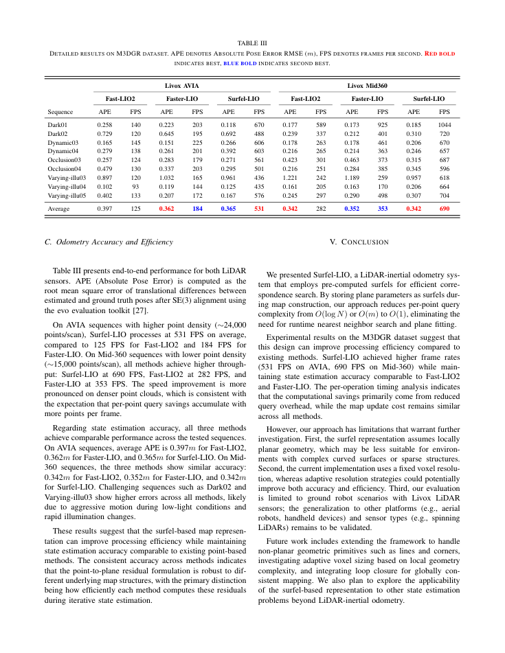

# Surfel-LIO

论文：[Surfel-LIO.pdf](../Surfel-LIO.pdf)。标题为 *Surfel-LIO: Fast LiDAR-Inertial Odometry with Pre-computed Surfels and Hierarchical Z-order Voxel Hashing*。

## 背景和相关研究

现代 IEKF-LIO 每次迭代都要对每个输入点做邻域搜索，再用邻域点 PCA 拟合平面。FAST-LIO2 用 ikd-Tree，Faster-LIO 用 iVox，但前者查询是 `O(log N)`，后者常需查询 7-27 个体素并仍在查询阶段 PCA。相同对应关系在多次 IEKF 迭代中不会改变，重复估计平面属于明显浪费。

Surfel-LIO 把 PCA 从查询阶段移到地图更新阶段，并把细粒度空间定位与稳定平面估计分到两个层级。

## 核心算法和推导

### 1) hVox 两级地图

L0 细体素只保存点的递推质心：

$$
\begin{aligned}
c_{n+1} &= (n c_{\mathrm{n}} + p_{\mathrm{new}})/(n+1)
\end{aligned}
$$

符号说明：$p_{new}$ 是新点，$c_n$ 是已有 $n$ 个点的质心，$c_{n+1}$ 是吸收该点后的质心。

每 `3 x 3 x 3` 个 L0 组成一个 L1 父体素。L1 不保存原始点，而收集其中有效 L0 质心 ${c_{\mathrm{i}}}$，计算：

$$
\begin{aligned}
c_{\mathrm{bar}} &= \operatorname{mean}_{i} c_{\mathrm{i}} \\
C &= \operatorname{mean}_{i} (c_{\mathrm{i}}-c_{\mathrm{bar}})(c_{\mathrm{i}}-c_{\mathrm{bar}})^\top
\end{aligned}
$$

符号说明：$c_i$ 是有效 L0 子体素质心，$c_{bar}$ 是这些质心的均值，$C$ 是其协方差。

特征分解 $C$ 得 $\lambda_{\mathrm{1}} \ge \lambda_{\mathrm{2}} \ge \lambda_{\mathrm{3}}$，surfel 法向 $n=v_{\mathrm{3}}$，中心为 $c_{\mathrm{bar}}$。平面可信度：

$$
\begin{aligned}
\rho = (\lambda_{\mathrm{2}}-\lambda_{\mathrm{3}})/(\lambda_{\mathrm{1}}+\epsilon)
\end{aligned}
$$

符号说明：$\lambda_1\ge\lambda_2\ge\lambda_3$ 是 $C$ 的特征值，$v_3$ 是最小特征方向并作为 surfel 法向；$\rho$ 是平面可信度，$\epsilon$ 避免分母为零。

$\rho < \rho_{\min}$ 的 surfel 不参与匹配。新点改变 L0 后只把对应 L1 标记为 dirty，当前扫描完成后统一重算一次，避免一个扫描内重复 PCA。

### 2) Morton/Z-order 哈希

将整数体素坐标 $(k_{\mathrm{x}},k_{\mathrm{y}},k_{\mathrm{z}})$ 的各轴二进制位交错成 Morton code：

$$
\begin{aligned}
M(kx,ky,kz) &= \sum_{i=0}^{20} (x_{\mathrm{i}} 4^{i} + y_{\mathrm{i}} 2 4^{i} + z_{\mathrm{i}} 4 4^{i})
\end{aligned}
$$

符号说明：$(k_x,k_y,k_z)$ 是整数体素坐标，$x_i,y_i,z_i$ 是各轴的第 $i$ 个二进制位；$M$ 将这些位交错编码为 Morton 键。

最多 21 位/轴。Z-order 让扫描中空间相近的连续点更可能访问相近 key，改善缓存；Robin Hood open addressing 减少冲突探测长度。查询过程只需量化坐标、计算 Morton code、哈希表读取 L1 surfel，不需要运行时邻域枚举或 PCA。

### 3) IEKF 观测

点到 surfel 平面残差：

$$
\begin{aligned}
r_{\mathrm{i}} &= n_{\mathrm{i}}^\top (R p_{\mathrm{i}}^{L} + p - c_{\mathrm{i}})
\end{aligned}
$$

符号说明：$p_i^L$ 是 LiDAR 系点，$R,p$ 是当前姿态和平移，$c_i,n_i$ 是匹配 surfel 的中心和法向；$r_i$ 是点面残差。

误差状态 $R_{\mathrm{true}}=R Exp(\delta \theta)$ 下，Jacobian 为：

$$
\begin{aligned}
H_{\mathrm{i}} &= [-n_{\mathrm{i}}^\top R [p_{\mathrm{i}}^{L}]_\times, n_{\mathrm{i}}^\top, 0_{1\times 9}]
\end{aligned}
$$

符号说明：$\delta\theta$ 表示旋转扰动，$[p_i^L]_\times$ 是叉乘矩阵；$H_i$ 的前两块对应旋转和平移，$0_{1\times9}$ 表示对其余状态分量无直接导数。

叠加所有有效 surfel 对应后，按普通 IEKF 迭代到收敛。由于 surfel 已在地图更新阶段固定，迭代期间只重算残差，不重算邻域和法向。

## 实验流程和结果

实验只使用 M3DGR 的 9 个序列，分别使用 Livox AVIA（约 24,000 点/帧）和 Mid-360（约 15,000 点/帧）；平台为 i7-14700KF、64 GB，所有方法体素 0.5 m、局部地图 200 x 200 m。

逐操作时间（Table II）：

| 操作 | FAST-LIO2 | Faster-LIO | Surfel-LIO |
| --- | ---: | ---: | ---: |
| NN search（us/点） | 1.42 | 2.76 | **0.05** |
| Plane estimation（us/点） | 0.17 | 0.61 | **0.01** |
| Map update（ms/帧） | 0.34 | 0.03 | 0.03 |

端到端 Table III 平均结果：

| LiDAR | FAST-LIO2 APE/FPS | Faster-LIO APE/FPS | Surfel-LIO APE/FPS |
| --- | ---: | ---: | ---: |
| AVIA | 0.397 m / 125 FPS | 0.362 m / 184 FPS | **0.365 m / 531 FPS** |
| Mid-360 | 0.342 m / 282 FPS | 0.352 m / 353 FPS | **0.342 m / 690 FPS** |

准确度基本相当，速度提升主要在点数更多的 AVIA 上更明显。第 3 页 Fig. 2 画出从点到体素 key、Morton code、哈希读取到 surfel 的完整路径；第 4 页 Fig. 3 说明 L0 质心和 L1 surfel 的分工；第 7 页表格给出逐序列 APE/FPS。

## 总结

Surfel-LIO 是一个很明确的“预计算换查询”方案：如果地图几何在一次 IEKF 更新中不会变化，就不应在每次查询重做 PCA。其适用边界也明确：固定尺度和局部平面假设在曲面、极稀疏环境中可能丢失有效约束，且论文尚未验证 UAV、手持和旋转式 LiDAR。

---

## 2026-11-15 PV-LIO-PLUS 集成状态

- 固定作者基线 `73348c1` 位于 `upstream/Surfel-LIO`。hVox 已在 feature `997c00a` 接入，并 cherry-pick 至主线 `c81f12f`；主线构建、链接、CTest 5/5（33 个 GTest 条目）及30秒完整回归通过。
- 集成保留 L0/L1 层级、更新期预计算 surfel、原生移动盒及 `GetSurfelAtPoint` 的包含体素查询；未以通用点容器代替该结构。对应的 `hvox_pko_ikfom` 使用分组内固定匹配、带符号点面残差、PKO 自适应尺度及 Huber 信息权重，适配共用 IKFoM 回调。
- 该观测适配不是作者 `Estimator` 的双循环复现。功能工作树构建、CTest 6/6（34 个 GTest 条目）、独立数学/源码核验和 30/141 秒完整输入回归通过；它们不是作者论文精度结果或受控性能比较。具体验证边界见[集成状态](../../doc/INTEGRATION_STATUS.md)和[hVox 机器记录](../../doc/workspace/evidence/HVOX_RESULTS.json)。
